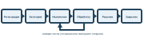
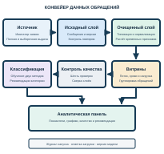

# 1.1 Характеристика обращений пользователей корпоративных ИС

Работа корпоративных ИС зависит от доступности сетевых служб, учётных записей, рабочих мест и прикладных программ. Нарушение работы любого из этих элементов приводит к обращению пользователя в СТП. Для восстановления работы СТП должна получить сведения о проблеме, назначить исполнителя и зафиксировать результат.

Под обращением в данной работе понимается зарегистрированное сообщение пользователя о нарушении работы сервиса либо о необходимости выполнить установленное действие. Обращение получает уникальный номер. С этого момента его состояние и действия специалистов отражаются в системе учёта заявок. Данное определение задаёт границу исследования: предметом обработки выступают записи об обращениях и их изменениях, а не сама эксплуатация ИС.

Организация работы СТП связана с управлением услугами в области информационных технологий. ГОСТ Р ИСО/МЭК 20000-1-2021 устанавливает требования к системе менеджмента сервисов [1]. Для настоящей работы существенны регистрация обращения, прослеживаемость его обработки и оценка результата. Эти действия создают данные, на основе которых можно анализировать качество обслуживания.

В корпоративной среде обращение может поступить через форму самообслуживания, электронную почту или специалиста первой линии. Способ поступления влияет на полноту первоначального описания. При заполнении формы пользователь выбирает некоторые значения из справочника. В письме те же сведения могут находиться только в свободном тексте. Поэтому единая запись об обращении должна объединять формализованные поля и текст сообщения.

Заявитель сообщает о проблеме и при необходимости уточняет её обстоятельства. Специалист СТП определяет характер обращения. Группа поддержки отвечает за выполнение работ в пределах своей компетенции. Руководитель использует накопленные сведения для контроля сроков и распределения нагрузки. Роли участников различаются, однако все они работают с одной заявкой на разных этапах её жизненного цикла.

Жизненный цикл обращения начинается с регистрации. На этом этапе фиксируются время создания, краткая тема, описание и сведения о затронутом сервисе. Затем обращение получает категорию и приоритет. Эти признаки нужны для выбора группы исполнителей и определения ожидаемого срока решения.

После назначения специалист проверяет исходные сведения. Неполное описание может потребовать уточнения у заявителя. В таком случае состояние обращения меняется, а переписка дополняет его историю. Для анализа длительности обработки недостаточно знать только время создания и закрытия. Требуются промежуточные события и причины ожидания.

Результат работы специалиста фиксируется в тексте решения. При необходимости заявитель подтверждает восстановление сервиса. Затем обращение закрывается. Если проблема повторяется, заявка может быть открыта повторно. Такой случай важен для оценки качества решения, поскольку формальное закрытие не всегда означает окончательное устранение причины.

Переходы между основными состояниями представлены на рисунке 1. Схема отражает принятую в макете модель процесса. Набор состояний в конкретной СТП может отличаться. При проектировании платформы данных необходимо сохранить исходное значение состояния и предусмотреть его приведение к согласованному справочнику.

*Рисунок 1 — Основные этапы обработки обращения*

*Таблица 1 — Этапы обработки обращения и состав возникающих данных*

| Этап | Основное действие | Данные, возникающие на этапе |
|---|---|---|
| Регистрация | Приём сообщения заявителя | Номер, время, тема, описание, сервис |
| Классификация | Определение характера и срочности | Категория, приоритет, контрольный срок |
| Назначение | Передача обращения исполнителю | Группа, специалист, время назначения |
| Обработка | Диагностика и уточнение | Состояния, сообщения, время первой реакции |
| Решение | Устранение проблемы | Время решения, текст выполненных действий |
| Закрытие | Подтверждение результата | Время закрытия, итоговое состояние |

Таблица 1 показывает, что данные об обращении возникают постепенно. Первоначальная запись дополняется сведениями о назначении, перепиской и решением. Следовательно, обращение следует рассматривать как изменяемую сущность. При передаче данных в аналитическую систему нужно различать новую заявку и новую версию ранее зарегистрированной заявки.

Структурированную часть записи образуют номер, категория, сервис, приоритет, состояние, исполнитель и временные отметки. Значения этих полей можно проверять по типу и допустимому диапазону. Например, время решения не должно предшествовать времени создания. Номер обращения не должен повторяться в таблице с последними состояниями заявок.

Неструктурированную часть обычно составляют описание проблемы, сообщения участников и текст решения. Пользователь может назвать один и тот же сбой разными словами. В тексте встречаются сокращения, неточные названия программ и сведения, не относящиеся к устранению проблемы. В макете сохраняются тема, описание и итоговый текст решения. Переписка участников не моделируется.

Для примера рассмотрим обращение о недоступности корпоративной почты. Поля «сервис» и «приоритет» позволяют включить заявку в отчёт по почтовым сервисам. Временные отметки дают возможность рассчитать длительность реакции и решения. Текст описания уточняет обстоятельства сбоя. Текст решения показывает выполненные действия, но его содержание нельзя восстановить из формализованных полей.

Одно обращение может менять состояние несколько раз. Например, после назначения специалист запрашивает уточнение, а затем возвращает заявку в работу. Если система передаёт только текущее состояние, часть истории теряется. Если система передаёт каждую версию целиком, возникает риск повторного учёта одной заявки. Платформа данных должна сохранять исходные версии и отдельно формировать актуальную запись.

Временные отметки служат основой для оценки сроков. Время первой реакции определяется как разность между моментом первого ответа и моментом регистрации. Время решения определяется как разность между моментом решения и моментом регистрации. Нарушение контрольного срока устанавливается сравнением времени решения с заданной границей. Для незавершённой заявки проверяется текущее превышение срока.

Анализ сроков требует единых правил обработки дат. Источник может хранить время в разных часовых поясах. Пустое поле решения может означать, что работа ещё продолжается. Ошибка преобразования даты способна исказить средние значения и долю просроченных заявок. ГОСТ Р 72663-2026 посвящён измерению качества данных [2]. В настоящей работе проверяются полнота обязательных полей, уникальность заявки и последовательность временных отметок.

Накопленная история обращений представляет интерес для нескольких видов анализа. По числу заявок можно определить периоды повышенной нагрузки и наиболее проблемные сервисы. По срокам реакции и решения можно выявить группы обращений с частыми нарушениями. По распределению заявок между исполнителями можно оценить текущую нагрузку СТП. Для каждого вида анализа требуется собственный набор измерений и показателей.

Прямое построение всех отчётов по рабочей системе обращений затрудняет разделение эксплуатационных и аналитических задач. Запросы к большому объёму истории могут конкурировать с операциями специалистов. Кроме того, рабочая запись не всегда содержит подготовленные значения для сравнения периодов. По этой причине в проекте предусматривается отдельное хранилище с последовательной подготовкой данных.

При хранении истории следует учитывать сведения о заявителях и исполнителях. Федеральный закон от 27 июля 2006 г. № 152-ФЗ определяет требования к обработке ПД [3]. Для учебного макета используются синтетические записи. В них отсутствуют реальные имена, адреса и содержание корпоративной переписки. Такой подход позволяет проверить обработку заявок без обращения к ПД работников организации.

Требование защищать сведения не сводится к замене имён. В истории обращений могут содержаться названия внутренних систем, признаки инфраструктуры и описание сбоев. Доктрина информационной безопасности Российской Федерации закреплена Указом Президента Российской Федерации от 5 декабря 2016 г. № 646 [4]. Поэтому при переходе от учебного макета к реальному источнику потребуется определить состав выгружаемых полей, порядок доступа и правила хранения.

На рисунке 2 представлен конвейер данных для рассматриваемой задачи. Отдельный источник передаёт новые и изменённые обращения. Исходный слой сохраняет версии сообщений. Очищенный слой содержит подготовленные записи. После формирования витрин выполняются проверки и классификация. Панель объединяет показатели, качество данных и рекомендации категории. Журнал обработки связывает все этапы.

*Рисунок 2 — Конвейер данных обращений технической поддержки*

Последовательность обработки представлена в алгоритме 1.

**Алгоритм 1 — Общая последовательность обработки обращений**

1. Получить из источника обращения, изменённые после последней успешно обработанной отметки времени.
2. Сохранить исходные сообщения и технические сведения о загрузке.
3. Проверить обязательные поля, привести типы данных и определить последнюю версию каждой заявки.
4. Рассчитать время реакции, время решения и факт нарушения контрольного срока.
5. Обновить аналитические показатели для дат, затронутых изменениями.
6. Проверить согласованность числа заявок между слоями.
7. Обучить или применить модель классификации и сохранить рекомендации категории.
8. Обновить отметку времени и записать результат запуска только после успешного завершения всех этапов.

Алгоритм учитывает изменяемый характер обращения. Повторная загрузка одной и той же версии не должна создавать вторую актуальную заявку. Ошибка на любом этапе не должна приводить к пропуску последующих изменений. Эти свойства определяют требования к хранению исходных записей, журналу запусков и порядку обновления отметки времени.

Таким образом, данные СТП сочетают формализованные признаки, свободный текст и историю изменений. Их аналитическая обработка требует отдельного конвейера, который сохраняет исходные записи и формирует согласованные показатели. В следующем подразделе рассматриваются структура этих данных и характерные нарушения их качества.
