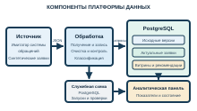

# 2.2 Архитектура и взаимодействие компонентов

Архитектура макета построена по принципу разделения функций. Источник формирует обращения. Служба обработки переносит данные, готовит признаки и применяет классификатор. База хранит версии, актуальные записи, рекомендации категории и витрины. Панель показывает результат. Все этапы связаны одним запуском конвейера.

Для размещения используются четыре контейнера. Конфигурация их запуска задаётся одним описанием Docker Compose. Документация средства определяет службы, сети и тома как основные элементы модели приложения [19]. Контейнеры отделяют источник, обработчик, базу PostgreSQL и панель. Повторение опыта не требует ручной настройки сетевых адресов. Классификация выполняется внутри обработчика и не создаёт отдельной службы.

Имитатор источника хранит текущее состояние обращений в SQLite. Её локальный файл достаточен для автономной выдачи синтетических заявок [20]. При первом запуске создаётся исходный набор. Служебный запрос добавляет новые заявки и изменяет часть ранее созданных. Данные источника отделены от аналитического хранилища.

Имитатор реализован на Python с помощью FastAPI. Выбор одного языка для источника, обработки, классификации и панели уменьшает число разных сред исполнения [21]. FastAPI проверяет параметры запросов и создаёт описание интерфейса [22]. Обработчик получает страницы обращений и отбирает их по времени изменения. Сообщения передаются в формате JSON. Контракт может быть представлен средствами OpenAPI [23].

Хранилищем выбрана PostgreSQL. Она объединяет реляционные таблицы, тип JSONB и операции с несколькими таблицами в одной транзакции. Это необходимо для согласованного обновления слоёв и отметки загрузки. Схемы разделяют исходные, очищенные, аналитические и служебные данные. Отдельная SQLite в источнике не участвует в расчёте витрин. Обоснование средств приведено в таблице 8.

*Таблица 8 — Роль и обоснование программных средств макета*

| Средство | Роль в конвейере | Причина выбора |
|---|---|---|
| Python | Источник, обработка, обучение и панель | Единые средства работы с данными и воспроизводимый запуск |
| FastAPI и SQLite | Автономный источник заявок | Проверяемый интерфейс и локальное состояние источника |
| PostgreSQL | Слои данных и состояние конвейера | Типизированные таблицы, JSONB и транзакции |
| Docker Compose | Сборка четырёх служб | Повторяемая конфигурация сети, томов и зависимостей |
| Streamlit и Plotly | Панель и графики | Просмотр витрин и результатов испытания [24] |
| Git | Учёт версий кода и конфигурации | Прослеживаемость изменений и подготовка репозитория [25] |

В аналитическом слое размещаются три витрины и таблица рекомендаций категории. Витрина потока использует дату, сервис, категорию, приоритет и состояние. Витрина сроков использует дату, сервис и приоритет. Витрина нагрузки использует дату, сервис, группу и исполнителя. Таблица рекомендаций содержит одну строку для каждой открытой заявки и ссылку на версию модели.

Панель обращается только к подготовленным данным. Она выводит поток обращений, сроки, нагрузку, результаты сравнения классификаторов и рекомендованные категории. Для построения графиков используются Streamlit и Plotly [24]. Прямое чтение синтетического источника не требуется. Поэтому работа панели не увеличивает нагрузку на источник.

Доступность источника контролируется перед запуском обработки. Контейнер базы также предоставляет признак готовности к подключениям. Служба обработки запускается после подтверждения обеих зависимостей. Это уменьшает число ошибок при первоначальном старте, когда компоненты создаются с разной скоростью.

Связи компонентов показаны на рисунке 3. Стрелки обозначают передачу данных или чтение результата. Направление обработки идёт от источника через подготовку и классификацию к аналитическому слою и панели. Служебная схема получает сведения о запусках и моделях. Панель читает эти сведения вместе с витринами.

*Рисунок 3 — Архитектура макета платформы данных*

Разделение на службы облегчает замену источника. При переходе к промышленной системе потребуется реализовать другой способ получения обращений и согласовать состав полей. Преобразования и витрины могут сохранять общую структуру при стабильном контракте. На практике такая замена потребует проверки прав доступа, ограничений выдачи и правил изменения заявок.

Размещение компонентов в отдельных контейнерах делает макет распределённым на уровне взаимодействия служб. Источник и обработчик обмениваются сообщениями через сеть. Обработчик и панель подключаются к базе как отдельные клиенты. Однако вычисления выполняются на одном персональном компьютере. Промышленная отказоустойчивость и горизонтальное масштабирование этим не подтверждаются.

Хранилище не имеет отдельного механизма архивации в пределах макета. Сохранность данных при обычном перезапуске обеспечивают тома контейнеров. Для промышленного применения потребуются резервные копии, восстановление и контроль доступности. Эти свойства не входят в измерение времени формирования витрин.

Обмен между службами ограничен необходимыми направлениями. Источник предоставляет чтение обращений и служебную операцию для испытаний. Обработчик записывает данные в хранилище. Панель читает витрины и сведения о запусках. Такое разграничение упрощает понимание потоков и проверку результата.

Состав компонентов выбран с учётом сроков выполнения ВКР. Дополнительная очередь сообщений или отдельное распределённое хранилище усложнили бы испытание. Для проверки полного пути от источника до рекомендации категории они не требуются. Git используется для фиксации кода и конфигурации перед публикацией, а не для передачи рабочих данных [25]. Возможность расширения архитектуры рассматривается при увеличении числа источников.

Таким образом, архитектура обеспечивает получение, подготовку, классификацию, хранение и представление данных в одном конвейере. Разделение на слои поддерживает прослеживаемость записи. Служебная схема фиксирует состояние и качество обработки. Далее рассматриваются структура таблиц и правила формирования показателей.
