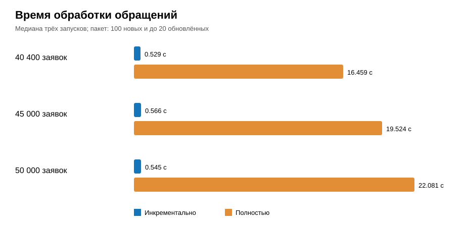

# 2.7 Испытание конвейера и интерпретация результатов

ГОСТ Р 59792-2021 устанавливает виды испытаний автоматизированных систем и общие требования к их проведению [29]. В работе выполнена исследовательская проверка автономного макета. Она не является приёмочным испытанием промышленной системы. Условия, действия и показатели зафиксированы для повторения опыта.

Сначала проверена работа классификаторов. На этапе их оценки в очищенном слое находилось 40 300 заявок. Из них 22 505 завершённых обращений имели категорию и использовались в обучении модели. Оставшиеся 17 795 открытых заявок получили рекомендации. Исходная категория при этом не изменялась.

Для сравнения методов 17 969 завершённых записей вошли в обучающую часть, 4536 — в проверочную. Доля проверочной части составила около 20 %. Разделение определялось идентификатором заявки. Оно было одинаковым для обоих методов. На каждом наборе вычислялись ошибка и усреднённая по категориям мера F1.

Отдельная проверка исключала по одной формулировке темы для каждой категории из обучающей части. Модели настраивались на остальных формулировках. Полученные оценки показывают перенос на ранее не встречавшиеся шаблоны. Этот набор использовался для выбора метода. Его результат следует рассматривать как проверку при выборе, а не как независимую оценку на реальных заявках.

Результаты сопоставления представлены в таблице 13. На обычном разделении обе модели дали одинаковую долю правильных ответов. Дополнительная проверка выявила существенную разницу между условиями опыта. Простое сравнение только по основной проверочной части скрыло бы это ограничение.

*Таблица 13 — Результаты сравнения методов классификации темы*

| Метод | Ошибка обучения | Ошибка проверки 20 % | F1 проверки 20 % | Точность новых шаблонов | F1 новых шаблонов |
|---|---:|---:|---:|---:|---:|
| Наивный байес | 0,0000 | 0,0000 | 1,0000 | 0,0000 | 0,0000 |
| Центроидный метод | 0,0000 | 0,0000 | 1,0000 | 0,2028 | 0,0808 |

Высокий результат на обычной проверочной части связан с повторением одних и тех же тем. Генератор формирует каждую категорию из трёх коротких шаблонов. Разные заявки с одинаковой темой попадают и в обучение, и в проверку. Поэтому значение 1,0000 не означает способность модели распознавать произвольные обращения пользователей.

На ранее не встречавшихся формулировках наивный байес не дал правильных ответов. Центроидный метод достиг доли 0,2028. Для пяти близких по объёму категорий такой уровень недостаточен для автоматического назначения. Он подтверждает зависимость обоих методов от состава обучающих тем. Промышленное применение потребует более разнообразной размеченной истории.

Центроидный метод выбран по показателю F1 на новых шаблонах. После выбора он обучен на всех 22 505 завершённых обращениях. Его версия и параметры сохранены в служебной схеме. Рекомендации этого этапа связаны с данной версией. Условная оценка близости не рассматривается как достоверная вероятность правильного ответа.

Второй опыт сравнивал полный и выборочный режимы всего конвейера. На трёх уровнях накопленной истории добавлялось по 100 новых обращений. Ещё 20 существующих заявок изменяли состояние. При каждом уровне выполнено три повтора. После каждого изменения последовательно запускались выборочная и полная обработка.

Выборочный запуск получал 120 записей. Полный запуск получал всю текущую историю. В пределах одного повтора оба режима работали с одним состоянием источника. Следующий повтор увеличивал накопленный объём ещё на 100 заявок. Это отклонение учтено при интерпретации медианных значений.

Измерение начиналось перед получением данных и завершалось после проверки качества и классификации. Использовался счётчик `perf_counter` [30]. Время создания контейнера не входило в итог. Отдельно сохранялась длительность извлечения, записи, преобразования, построения витрин и моделирования.

Для каждой группы рассчитана медиана трёх запусков. Она уменьшает влияние одного случайного замера. Число повторов остаётся небольшим. На длительность могли повлиять состояние кэша и фоновые процессы компьютера. Все значения относятся к одному программному окружению.

Испытание выполнено на компьютере с Docker Desktop, PostgreSQL 16 и Python 3.12. Виртуальной среде были доступны 16 логических процессоров и 15,07 гибибайта памяти. Конфигурация служб во всех сериях оставалась одинаковой. Синтетический источник и аналитическая база работали на одном компьютере.

Медианные результаты приведены в таблице 14. Время включает обучение модели при полном режиме и применение сохранённой модели при выборочном. Отношение времени рассчитано делением полного времени на выборочное. Отдельно показана длительность обновления витрин.

*Таблица 14 — Время работы конвейера с классификацией*

| Базовый объём заявок | Получено выборочно | Выборочно, с | Полностью, с | Отношение времени | Витрины выборочно, с | Витрины полностью, с |
|---:|---:|---:|---:|---:|---:|---:|
| 40 400 | 120 | 0,529 | 16,459 | 31,11 | 0,218 | 0,256 |
| 45 000 | 120 | 0,566 | 19,524 | 34,49 | 0,262 | 0,241 |
| 50 000 | 120 | 0,545 | 22,081 | 40,52 | 0,259 | 0,272 |

На рисунке 4 показано общее время работы конвейера. При увеличении истории от 40 400 до 50 000 заявок полный режим замедлился с 16,459 до 22,081 с. Выборочный режим обрабатывал неизменный по размеру пакет за 0,529–0,566 с. Наибольшее отношение времени составило 40,52.

*Рисунок 4 — Медианное время работы конвейера с классификацией*

Основной выигрыш обеспечен сокращением объёма получения и преобразования. Полный режим также переобучал модель на завершённых заявках. Выборочный режим использовал уже сохранённую версию. Поэтому отношение общего времени не следует трактовать как ускорение только операции построения витрин. Оно характеризует полный путь обновления результата.

Длительность самого аналитического слоя не показала устойчивого преимущества одного режима. При 45 000 заявок выборочное построение заняло 0,262 с против 0,241 с в полном режиме. На двух других уровнях выборочный режим оказался немного быстрее. На результат влияют определение затронутых дат и повторное вычисление их срезов. Это ограничение показывает направление дальнейшей оптимизации.

После завершения опыта в очищенном слое находилось 50 300 заявок. Их число было равно суммам счётчиков каждой из трёх витрин. Повторный выборочный запуск без изменения источника не добавлял обращения. Все шесть обязательных проверок качества завершились успешно. Эти наблюдения подтверждают согласованность показателей в проверенных сценариях.

Панель превращает результаты конвейера в доступные для анализа представления. Линейный график показывает поток заявок по датам и сервисам. Диаграммы категорий и приоритетов раскрывают структуру обращений. Раздел сроков показывает долю нарушений и длительность решения. Раздел нагрузки позволяет сравнить группы и исполнителей.

Отдельный раздел панели показывает сравнение двух классификаторов и рекомендации для открытых заявок. Рядом выводятся состояние запусков и результаты проверок качества. Технический журнал содержит номер запуска, этап, число записей и время. Дополнительный экран специалиста показывает похожие закрытые заявки и редактируемую рекомендацию. Решение о её использовании сохраняется отдельно. Низкое качество классификации на новых формулировках требует ручной проверки.

Практическая ценность макета состоит в воспроизводимом получении актуальных показателей без обращения панели к рабочему источнику. Реализованы выборочная загрузка, история версий, контроль качества, сравнение моделей и представление результата. Эти функции демонстрируют работу инженера данных как завершённый процесс от источника до потребителя. Порядок воспроизведения приведён в приложении Б.

Границы вывода определяются синтетическим набором и локальным стендом. Источник не воспроизводит задержки и ограничения реальной СТП. Классификаторы обучены на повторяющихся темах и не готовы к автоматическому назначению категории. Поиск похожих обращений основан на совпадении слов; его качество не измерялось и в показатели испытания конвейера не включалось. Для внедрения необходимы реальные размеченные данные, проверка защиты сведений и опыт с иной нагрузкой.
