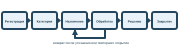
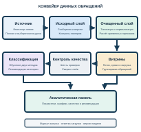
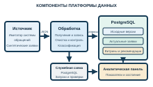
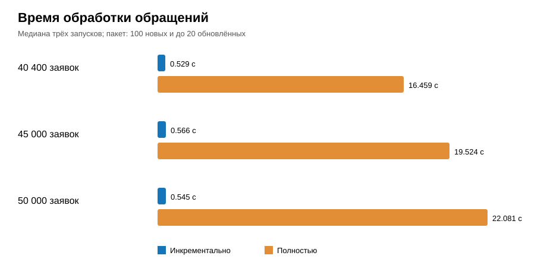

# Проектирование распределённой платформы сбора, хранения и обработки данных об обращениях пользователей корпоративных ИТ-сервисов

# Введение

Работа корпоративных информационных систем (ИС) сопровождается обращениями пользователей по вопросам доступа, оборудования и прикладных программ. Эти системы предоставляют сервисы в области информационных технологий (ИТ-сервисы). Служба технической поддержки (СТП) регистрирует обращения и фиксирует действия специалистов. По мере эксплуатации ИС формируется история заявок. Она содержит сведения о состоянии ИТ-сервисов и работе СТП.

Актуальность исследования связана с необходимостью использовать эту историю для анализа. Руководителю СТП нужны данные о числе обращений, сроках решения и распределении нагрузки. Подготовка таких сведений непосредственно в рабочей системе может потребовать повторного чтения всей истории. При увеличении объёма заявок возрастает время формирования отчётов. ГОСТ Р ИСО/МЭК 20000-1-2021 предусматривает мониторинг, измерение и анализ системы менеджмента сервисов [1].

Данные об обращениях неоднородны. Категория, приоритет, состояние и даты имеют заданную структуру. Описание проблемы и текст решения составляются в свободной форме. Записи изменяются в ходе работы специалиста. Повторная передача одной заявки может привести к двойному учёту. Поэтому до формирования показателей и классификации необходимы проверка, приведение типов и выделение актуальной версии. Подходы к измерению качества данных представлены в ГОСТ Р 72663-2026 [2].

При использовании реальной истории требуется учитывать ограничения на обработку персональных данных (ПД). Они установлены Федеральным законом от 27 июля 2006 г. № 152-ФЗ [3]. Сведения о внутренней инфраструктуре также требуют защиты. Общие ориентиры в этой области закреплены Доктриной информационной безопасности Российской Федерации [4]. В настоящей выпускной квалификационной работе (ВКР) используется синтетический набор заявок. Он позволяет проверить архитектуру без доступа к данным организации.

Объектом исследования являются процессы сбора, хранения и обработки данных об обращениях пользователей корпоративных ИТ-сервисов. Предмет исследования составляют архитектура многоуровневой платформы, модель данных, способы обновления аналитических витрин и включение классификации в конвейер. Под витриной понимается подготовленный набор показателей для решения определённой аналитической задачи.

Цель работы — сокращение времени формирования аналитических витрин по обращениям пользователей корпоративных ИТ-сервисов посредством применения многоуровневой платформы данных. Для достижения цели необходимо решить три задачи:

1. Проанализировать предметную область, состав данных об обращениях и подходы к организации многоуровневого хранения.
2. Разработать архитектуру платформы и макет конвейера для подготовки данных, классификации обращений и формирования аналитических витрин.
3. Оценить время полного и выборочного обновления витрин, а также качество классификации на отдельной проверочной выборке.

В работе применяются анализ предметной области, моделирование данных, проектирование программных компонентов и экспериментальное сравнение способов обработки. Для оценки используются время выполнения конвейера, число обработанных записей и результаты проверок качества. Два способа классификации сравниваются на общей проверочной выборке. Пакеты одинакового размера обрабатываются при нескольких объёмах накопленной истории.

Практическим результатом является автономный макет платформы. Источник заявок воспроизводится программным интерфейсом. Данные проходят исходный и очищенный слои. На подготовленных записях обучается классификатор. Его результаты и показатели обращений доступны через аналитический слой и панель. Компоненты запускаются в отдельных контейнерах. Реальная интеграция с системой обращений предприятия в объём работы не входит.

Классификация помогает определить тематическую группу нового обращения. Она служит примером применения методов искусственного интеллекта (ИИ) к подготовленным данным. Развитие технологий ИИ предусмотрено Указом Президента Российской Федерации от 10 октября 2019 г. № 490 [5]. Поиск похожих решений и создание проекта ответа рассматриваются как дальнейшее развитие платформы.

Работа состоит из введения, двух глав, заключения, глоссария, списка источников и приложений. Её структура и оформление соотнесены с ГОСТ 7.32-2017 [6]. В первой главе рассматриваются данные обращений и подходы к их обработке. Во второй главе представлены архитектура, последовательность работы конвейера, программная реализация и результаты испытаний. В приложениях приводятся структура проекта и материалы испытаний.

# Глава 1. Анализ предметной области и архитектурных подходов к обработке данных обращений технической поддержки

# 1.1 Характеристика обращений пользователей корпоративных ИС

Работа корпоративных ИС зависит от доступности сетевых служб, учётных записей, рабочих мест и прикладных программ. Нарушение работы любого из этих элементов приводит к обращению пользователя в СТП. Для восстановления работы СТП должна получить сведения о проблеме, назначить исполнителя и зафиксировать результат.

Под обращением в данной работе понимается зарегистрированное сообщение пользователя о нарушении работы сервиса либо о необходимости выполнить установленное действие. Обращение получает уникальный номер. С этого момента его состояние и действия специалистов отражаются в системе учёта заявок. Данное определение задаёт границу исследования: предметом обработки выступают записи об обращениях и их изменениях, а не сама эксплуатация ИС.

Организация работы СТП связана с управлением услугами в области информационных технологий. ГОСТ Р ИСО/МЭК 20000-1-2021 устанавливает требования к системе менеджмента сервисов [1]. Для настоящей работы существенны регистрация обращения, прослеживаемость его обработки и оценка результата. Эти действия создают данные, на основе которых можно анализировать качество обслуживания.

В корпоративной среде обращение может поступить через форму самообслуживания, электронную почту или специалиста первой линии. Способ поступления влияет на полноту первоначального описания. При заполнении формы пользователь выбирает некоторые значения из справочника. В письме те же сведения могут находиться только в свободном тексте. Поэтому единая запись об обращении должна объединять формализованные поля и текст сообщения.

Заявитель сообщает о проблеме и при необходимости уточняет её обстоятельства. Специалист СТП определяет характер обращения. Группа поддержки отвечает за выполнение работ в пределах своей компетенции. Руководитель использует накопленные сведения для контроля сроков и распределения нагрузки. Роли участников различаются, однако все они работают с одной заявкой на разных этапах её жизненного цикла.

Жизненный цикл обращения начинается с регистрации. На этом этапе фиксируются время создания, краткая тема, описание и сведения о затронутом сервисе. Затем обращение получает категорию и приоритет. Эти признаки нужны для выбора группы исполнителей и определения ожидаемого срока решения.

После назначения специалист проверяет исходные сведения. Неполное описание может потребовать уточнения у заявителя. В таком случае состояние обращения меняется, а переписка дополняет его историю. Для анализа длительности обработки недостаточно знать только время создания и закрытия. Требуются промежуточные события и причины ожидания.

Результат работы специалиста фиксируется в тексте решения. При необходимости заявитель подтверждает восстановление сервиса. Затем обращение закрывается. Если проблема повторяется, заявка может быть открыта повторно. Такой случай важен для оценки качества решения, поскольку формальное закрытие не всегда означает окончательное устранение причины.

Переходы между основными состояниями представлены на рисунке 1. Схема отражает принятую в макете модель процесса. Набор состояний в конкретной СТП может отличаться. При проектировании платформы данных необходимо сохранить исходное значение состояния и предусмотреть его приведение к согласованному справочнику.

*Рисунок 1 — Основные этапы обработки обращения*

*Таблица 1 — Этапы обработки обращения и состав возникающих данных*

| Этап | Основное действие | Данные, возникающие на этапе |
|---|---|---|
| Регистрация | Приём сообщения заявителя | Номер, время, тема, описание, сервис |
| Классификация | Определение характера и срочности | Категория, приоритет, контрольный срок |
| Назначение | Передача обращения исполнителю | Группа, специалист, время назначения |
| Обработка | Диагностика и уточнение | Состояния, сообщения, время первой реакции |
| Решение | Устранение проблемы | Время решения, текст выполненных действий |
| Закрытие | Подтверждение результата | Время закрытия, итоговое состояние |

Таблица 1 показывает, что данные об обращении возникают постепенно. Первоначальная запись дополняется сведениями о назначении, перепиской и решением. Следовательно, обращение следует рассматривать как изменяемую сущность. При передаче данных в аналитическую систему нужно различать новую заявку и новую версию ранее зарегистрированной заявки.

Структурированную часть записи образуют номер, категория, сервис, приоритет, состояние, исполнитель и временные отметки. Значения этих полей можно проверять по типу и допустимому диапазону. Например, время решения не должно предшествовать времени создания. Номер обращения не должен повторяться в таблице с последними состояниями заявок.

Неструктурированную часть обычно составляют описание проблемы, сообщения участников и текст решения. Пользователь может назвать один и тот же сбой разными словами. В тексте встречаются сокращения, неточные названия программ и сведения, не относящиеся к устранению проблемы. В макете сохраняются тема, описание и итоговый текст решения. Переписка участников не моделируется.

Для примера рассмотрим обращение о недоступности корпоративной почты. Поля «сервис» и «приоритет» позволяют включить заявку в отчёт по почтовым сервисам. Временные отметки дают возможность рассчитать длительность реакции и решения. Текст описания уточняет обстоятельства сбоя. Текст решения показывает выполненные действия, но его содержание нельзя восстановить из формализованных полей.

Одно обращение может менять состояние несколько раз. Например, после назначения специалист запрашивает уточнение, а затем возвращает заявку в работу. Если система передаёт только текущее состояние, часть истории теряется. Если система передаёт каждую версию целиком, возникает риск повторного учёта одной заявки. Платформа данных должна сохранять исходные версии и отдельно формировать актуальную запись.

Временные отметки служат основой для оценки сроков. Время первой реакции определяется как разность между моментом первого ответа и моментом регистрации. Время решения определяется как разность между моментом решения и моментом регистрации. Нарушение контрольного срока устанавливается сравнением времени решения с заданной границей. Для незавершённой заявки проверяется текущее превышение срока.

Анализ сроков требует единых правил обработки дат. Источник может хранить время в разных часовых поясах. Пустое поле решения может означать, что работа ещё продолжается. Ошибка преобразования даты способна исказить средние значения и долю просроченных заявок. ГОСТ Р 72663-2026 посвящён измерению качества данных [2]. В настоящей работе проверяются полнота обязательных полей, уникальность заявки и последовательность временных отметок.

Накопленная история обращений представляет интерес для нескольких видов анализа. По числу заявок можно определить периоды повышенной нагрузки и наиболее проблемные сервисы. По срокам реакции и решения можно выявить группы обращений с частыми нарушениями. По распределению заявок между исполнителями можно оценить текущую нагрузку СТП. Для каждого вида анализа требуется собственный набор измерений и показателей.

Прямое построение всех отчётов по рабочей системе обращений затрудняет разделение эксплуатационных и аналитических задач. Запросы к большому объёму истории могут конкурировать с операциями специалистов. Кроме того, рабочая запись не всегда содержит подготовленные значения для сравнения периодов. По этой причине в проекте предусматривается отдельное хранилище с последовательной подготовкой данных.

При хранении истории следует учитывать сведения о заявителях и исполнителях. Федеральный закон от 27 июля 2006 г. № 152-ФЗ определяет требования к обработке ПД [3]. Для учебного макета используются синтетические записи. В них отсутствуют реальные имена, адреса и содержание корпоративной переписки. Такой подход позволяет проверить обработку заявок без обращения к ПД работников организации.

Требование защищать сведения не сводится к замене имён. В истории обращений могут содержаться названия внутренних систем, признаки инфраструктуры и описание сбоев. Доктрина информационной безопасности Российской Федерации закреплена Указом Президента Российской Федерации от 5 декабря 2016 г. № 646 [4]. Поэтому при переходе от учебного макета к реальному источнику потребуется определить состав выгружаемых полей, порядок доступа и правила хранения.

На рисунке 2 представлен конвейер данных для рассматриваемой задачи. Отдельный источник передаёт новые и изменённые обращения. Исходный слой сохраняет версии сообщений. Очищенный слой содержит подготовленные записи. После формирования витрин выполняются проверки и классификация. Панель объединяет показатели, качество данных и рекомендации категории. Журнал обработки связывает все этапы.

*Рисунок 2 — Конвейер данных обращений технической поддержки*

Последовательность обработки представлена в алгоритме 1.

**Алгоритм 1 — Общая последовательность обработки обращений**

1. Получить из источника обращения, изменённые после последней успешно обработанной отметки времени.
2. Сохранить исходные сообщения и технические сведения о загрузке.
3. Проверить обязательные поля, привести типы данных и определить последнюю версию каждой заявки.
4. Рассчитать время реакции, время решения и факт нарушения контрольного срока.
5. Обновить аналитические показатели для дат, затронутых изменениями.
6. Проверить согласованность числа заявок между слоями.
7. Обучить или применить модель классификации и сохранить рекомендации категории.
8. Обновить отметку времени и записать результат запуска только после успешного завершения всех этапов.

Алгоритм учитывает изменяемый характер обращения. Повторная загрузка одной и той же версии не должна создавать вторую актуальную заявку. Ошибка на любом этапе не должна приводить к пропуску последующих изменений. Эти свойства определяют требования к хранению исходных записей, журналу запусков и порядку обновления отметки времени.

Таким образом, данные СТП сочетают формализованные признаки, свободный текст и историю изменений. Их аналитическая обработка требует отдельного конвейера, который сохраняет исходные записи и формирует согласованные показатели. В следующем подразделе рассматриваются структура этих данных и характерные нарушения их качества.

# 1.2 Состав данных об обращениях и требования к их качеству

Аналитическая обработка обращений начинается с определения состава исходной записи. В пределах одной заявки объединяются сведения о заявителе, затронутом сервисе, назначенном специалисте и ходе решения. Часть сведений появляется при регистрации. Остальные поля заполняются после изменения состояния обращения. Это обстоятельство необходимо учитывать при построении модели данных.

Основной единицей учёта является обращение. Каждому обращению соответствует идентификатор в системе источника. По нему связываются последовательные версии заявки. В аналитическом слое идентификатор позволяет не учитывать одну заявку несколько раз после её обновления.

Для описания обращения используются несколько групп полей. Первая группа характеризует содержание проблемы: тема, категория, сервис и текст заявки. Вторая группа отражает организацию работ: приоритет, группа поддержки и исполнитель. Третья группа содержит временные отметки и состояние. Отдельно хранится текст решения.

Идентификатор должен оставаться неизменным на протяжении жизненного цикла заявки. Значение этого поля не зависит от изменения исполнителя или состояния. Если источник передал два сообщения с одинаковым идентификатором, необходимо сравнить время изменения и содержимое. Простое удаление одного из сообщений может привести к потере истории.

Описание проблемы и текст решения не имеют постоянной внутренней структуры. Пользователь может указать название программы, сообщение об ошибке и обстоятельства сбоя в произвольном порядке. Специалист фиксирует действия в привычной для него форме. Эти поля следует сохранять без сокращения. В дальнейшем они могут использоваться для поиска похожих обращений.

В рассматриваемом макете источник передаёт записи в формате структурированных данных (JSON). Спецификация RFC 8259 определяет правила представления объектов, массивов и значений в JSON [7]. Такой способ передачи позволяет включить в одно сообщение обязательные поля и свободный текст. При этом наличие поля в сообщении ещё не гарантирует правильность его значения.

Для каждой заявки необходима явная схема преобразования полей. Номер приводится к целочисленному типу. Временные отметки преобразуются в значения даты и времени. Пустые строки в необязательных полях заменяются отсутствующим значением. Пустые значения категории и состояния получают специальные пометки.

Поле времени создания фиксирует начало жизненного цикла. Время последнего изменения показывает актуальность версии. Время первой реакции нужно для оценки работы первой линии. Время решения используется для расчёта длительности обработки. Время закрытия может отличаться от времени решения, поскольку заявитель подтверждает результат позднее.

Отметка последнего изменения имеет особое значение для загрузки новых данных. При повторном обращении к источнику система может запросить записи, изменённые после успешно обработанного момента. В таком случае объём передаваемых данных зависит от числа изменений, а не от всей накопленной истории. Отметка должна обновляться лишь после завершения обработки полученного пакета.

Состояние обращения определяет его положение в процессе. Однако одинаковые по смыслу состояния в разных системах могут называться по-разному. Например, результат работы специалиста может обозначаться как «Решена» или «Выполнена». При объединении данных необходимо сохранить исходное значение и определить единый аналитический признак.

Качество данных характеризует пригодность записей для конкретной задачи. ГОСТ Р 71484.2-2024 описывает показатели качества данных для аналитики и машинного обучения [8]. Для настоящей работы существенны полнота, согласованность и отсутствие повторов. Эти свойства проверяются до расчёта витрин.

Полнота означает наличие полей, без которых нельзя выполнить расчёт. Заявка без идентификатора не может быть связана со своей предыдущей версией. Заявка без времени создания не может быть отнесена к отчётному периоду. При отсутствии категории возможно временно использовать значение «Не определена». Такой случай следует учитывать отдельно в отчёте о качестве.

Согласованность требует соблюдения связей между полями. Время решения не может предшествовать времени создания. Закрытая заявка обычно содержит итоговое решение. Приоритет должен соответствовать установленному набору значений. Нарушение этих правил не всегда означает ошибку пользователя. Оно может возникнуть при переносе данных между системами или неправильном преобразовании формата.

Повторы возникают при повторной передаче уже обработанной версии. Они отличаются от нескольких версий одной заявки. Повтор представляет то же содержимое без новых изменений. Новая версия содержит обновлённое состояние, исполнителя или текст решения. Для различения этих случаев можно использовать идентификатор, время изменения и контрольное значение содержимого.

При обработке свободного текста необходимы дополнительные меры. В описании могут находиться адреса, имена и иные ПД. В учебном источнике такие сведения не создаются. При подключении реальной СТП потребуется выделить поля ограниченного доступа и проверить текстовые сообщения перед передачей в аналитическую платформу.

Состав полей и основные проверки приведены в таблице 2. Она связывает исходные данные с показателями, которые формируются в последующих слоях. Перечень отражает требования рассматриваемого макета. При подключении другого источника он должен уточняться по фактической схеме системы обращений.

*Таблица 2 — Состав данных об обращении и требования к проверке*

| Группа полей | Примеры | Проверка | Использование |
|---|---|---|---|
| Идентификация | Номер заявки | Заполненность, уникальность актуальной версии | Связь изменений одной заявки |
| Содержание | Тема, описание, решение | Наличие темы, сохранность текста | Анализ тематики и истории решений |
| Классификация | Сервис, категория, приоритет | Допустимые значения | Разрезы аналитических витрин |
| Участники | Группа, исполнитель | Заполненность группы | Оценка нагрузки |
| Состояние | Статус, число повторных открытий | Согласованность с датами | Анализ жизненного цикла |
| Время | Создание, реакция, решение, изменение | Тип, порядок дат | Сроки и выборочная загрузка |

Таблица 2 показывает связь между качеством исходных полей и надёжностью итогового показателя. Ошибка в идентификаторе искажает количество заявок. Ошибка во времени решения влияет на долю нарушений срока. Отсутствие исполнителя затрудняет оценку нагрузки. Поэтому результаты проверок следует сохранять вместе со сведениями о запуске конвейера.

До выбора способа классификации проведён первичный анализ синтетического набора. На 7 ноября 2026 г. очищенный слой содержал 22 300 обращений. Пять категорий представлены близким числом записей. Для 9577 заявок текст решения отсутствует. Их нельзя использовать как примеры завершённого решения при обучении модели. Основные характеристики приведены в таблице 3.

*Таблица 3 — Распределение синтетических обращений по категориям и состояниям*

| Признак | Значение | Число обращений |
|---|---|---:|
| Категория | Почта | 4482 |
| Категория | Оборудование и ПО | 4476 |
| Категория | Бизнес-приложения | 4461 |
| Категория | Сетевой доступ | 4459 |
| Категория | Управление доступом | 4422 |
| Состояние | Закрыта | 9726 |
| Состояние | Решена | 2997 |
| Состояние | В работе | 4005 |
| Состояние | Ожидает уточнения | 3214 |
| Состояние | Новая | 2358 |

Распределение категорий почти равномерно, поскольку оно задано генератором. Темы заявок выбираются из ограниченного набора шаблонов. Следовательно, высокое качество классификации на случайно выделенной части этого набора не доказывает работу на реальных обращениях. Для проверки обобщения следует отдельно оценить предсказания по формулировкам, отсутствовавшим при обучении.

Таким образом, запись об обращении представляет собой изменяемый набор структурированных и текстовых данных. Для аналитики необходимо отделить исходные сообщения от актуального состояния заявки. Следующий подраздел посвящён подходам к хранению и последовательной подготовке этих данных.

# 1.3 Подходы к хранению и обработке данных обращений

Выбор архитектуры зависит от характера исходных данных и состава аналитических задач. Запись об обращении меняется на протяжении обработки. Отчётным показателям требуется актуальное состояние заявки. При этом проверка ошибок и повторное построение показателей требуют доступа к исходным версиям. Одной таблицы для этих целей недостаточно.

Наиболее простой подход состоит в построении отчётов непосредственно по системе обращений. Он не требует отдельного хранилища. Однако каждый отчёт должен заново выполнять отбор, преобразование дат и группировку. Запросы аналитиков используют те же вычислительные ресурсы, что и операции специалистов СТП. При увеличении истории нагрузка на рабочую систему возрастает.

Другой подход предполагает копирование обращений в отдельную базу. Такое решение отделяет аналитику от текущей работы СТП. В скопированных данных можно создать индексы и заранее вычислить некоторые показатели. Однако простая копия сохраняет ошибки и неоднородность исходной схемы. При изменении заявки необходимо определить, какая версия должна участвовать в отчёте.

Передача данных из источника возможна через программный интерфейс, прямое чтение базы или файлы выгрузки. Сравнение приведено в таблице 4. Критериями служат доступ к рабочей системе, повторяемость загрузки и возможность получать изменения. Для учебного макета выбран программный интерфейс. Он позволяет воспроизвести обмен между независимыми компонентами без доступа к базе предприятия.

*Таблица 4 — Сравнение способов получения данных об обращениях*

| Способ | Преимущество | Ограничение для данной задачи |
|---|---|---|
| Программный интерфейс | Явный состав полей и отбор изменений | Требует реализации клиента и согласования договора обмена |
| Прямое чтение базы | Доступ к подробным таблицам | Зависимость от внутренней схемы и прав доступа |
| Файловая выгрузка | Простая передача отдельного набора | Необходимость отслеживать изменения и целостность файлов |

Автономный источник воспроизводит назначение интерфейса СТП, но не заявляет совместимости с закрытым интерфейсом IntraService. Записи выдаются страницами по запросу. Для выборочного режима предусмотрен отбор по времени изменения. Такой договор обмена делает этап получения данных наблюдаемым. При подключении реального источника потребуется проверить доступные операции и состав возвращаемых полей.

Для рассматриваемой задачи выбран многоуровневый подход. Он разделяет получение сообщений, подготовку актуальных записей и расчёт показателей. В документации Azure Databricks такая последовательность описана как архитектура Bronze, Silver и Gold [9]. В данной работе эти названия соответствуют исходному, очищенному и аналитическому слоям. Используется принцип разделения слоёв, а не программная платформа Azure Databricks.

Исходный слой получает сообщения в том виде, в каком их передал источник. Вместе с содержимым сохраняются номер заявки, время изменения и сведения о загрузке. Этот слой нужен для проверки происхождения записи и повторного выполнения преобразований. Если правила очистки изменятся, последующие слои можно построить заново без повторной выгрузки всей истории из СТП.

Для хранения сообщений применяется двоичный тип JSON (JSONB) базы PostgreSQL. Он позволяет работать с полями документа и поддерживает индексацию. При этом JSONB не сохраняет порядок ключей и исходные пробелы текстового сообщения [10]. Поэтому выражение «сохранение исходного сообщения» в данном макете относится к сохранению значений полей, а не к побайтовой копии ответа программного интерфейса.

Очищенный слой содержит одну актуальную запись для каждого обращения. На этом этапе значения приводятся к заданным типам. Проверяются обязательные поля и временная последовательность. Для поиска последней версии используются идентификатор и время изменения. Сведения, не прошедшие проверку, должны быть отражены в журнале качества.

Аналитический слой содержит заранее рассчитанные показатели. Для него определяется зерно каждой витрины, то есть набор признаков, соответствующий одной строке. Витрина потока обращений группирует заявки по дате, сервису, категории, приоритету и состоянию. Витрина сроков объединяет число заявок, число решений и нарушения контрольного срока. Витрина нагрузки распределяет обращения между группами и исполнителями.

Разделение слоёв упрощает проверку результатов. Количество актуальных заявок в очищенном слое можно сравнить с суммой заявок в каждой витрине. При расхождении становится возможным определить этап появления ошибки. Исходный слой служит основанием для повторного расчёта. Очищенный слой показывает результат нормализации. Аналитический слой отражает применение правил группировки.

Основные варианты организации хранения сопоставлены в таблице 5. Сравнение проводится по критериям, связанным с задачей ВКР. Оцениваются сохранение истории, влияние на рабочую систему, возможность повторной обработки и готовность данных к анализу.

*Таблица 5 — Сравнение подходов к организации аналитической обработки обращений*

| Подход | История версий | Нагрузка на рабочую СТП | Повторное построение | Подготовка показателей |
|---|---|---|---|---|
| Отчёт по источнику | Зависит от источника | Высокая при частых запросах | Ограничена доступными данными | В каждом запросе |
| Отдельная копия заявок | Обычно сохраняется актуальная версия | Низкая после загрузки | Ограничена составом копии | Требует преобразований |
| Три слоя хранения | Сохраняется в исходном слое | Низкая после загрузки | Выполняется из исходного слоя | Выполнена в витринах |

При большом числе заявок полное обновление всех слоёв после каждого изменения нецелесообразно. Оно повторно передаёт неизменившиеся сообщения и увеличивает время обработки. Поэтому система должна поддерживать загрузку только новых и изменённых заявок. Полный режим сохраняется для первоначального заполнения и контрольного восстановления витрин.

Для выборочной загрузки источник должен предоставлять признак изменения. В рассматриваемом макете таким признаком служит поле времени последнего обновления. После успешного запуска сохраняется наибольшее обработанное значение. Следующий запрос использует его как нижнюю границу. Документация Airbyte описывает аналогичное применение поля курсора при выборочной синхронизации [11].

Одного ограничения по времени недостаточно для корректного обновления хранилища. Повторный запуск может получить ранее переданное сообщение. Для этого операция записи должна выдерживать повторы. В очищенном слое идентификатор заявки используется как уникальный ключ. Если новая версия уже существует, её поля обновляются. Если идентификатор отсутствует, создаётся новая строка. Такой принцип применяется в инкрементальных моделях dbt [12].

В исходном слое повторы следует отличать от истории изменений. Совпадение идентификатора и контрольного значения содержимого указывает на повторную передачу той же версии. Изменение контрольного значения означает новую версию. Сохранение обеих версий позволяет восстановить ход обработки. В очищенный слой передаётся только последняя допустимая версия.

Аналитические витрины обновляются по датам, затронутым новым пакетом. Если изменилось состояние заявки, соответствующая дата её создания должна быть пересчитана. Для каждого затронутого дня старые агрегаты заменяются новыми. Такой порядок проще проверить, чем прибавление отдельных изменений к уже рассчитанным числам. Он снижает риск ошибки при повторной обработке одной заявки.

Выборочное обновление имеет ограничения. Заявки из пакета могут относиться ко многим отчётным датам. В таком случае частичный пересчёт затронет значительную часть витрины. Кроме того, при изменении правил расчёта потребуется полное построение. Поэтому архитектура предусматривает оба режима и измеряет их время при одинаковых условиях.

Для определения категории по теме обращения рассмотрены правила по ключевым словам и два обучаемых метода. Наивный байес оценивает связь слов с категориями. Центроидный метод сравнивает текст с типичным представлением каждой категории. Оба метода допускают обучение на подготовленных записях без дополнительной вычислительной службы [13, 14]. Правила требуют ручного сопровождения словаря. Сравнение подходов приведено в таблице 6.

*Таблица 6 — Сравнение способов классификации темы обращения*

| Способ | Преимущество | Ограничение | Роль в макете |
|---|---|---|---|
| Правила по словам | Прозрачное решение | Ручное обновление при новых формулировках | Рассмотренный вариант |
| Наивный байес | Быстрое обучение на коротких текстах | Предположение об условной независимости слов | Первый испытываемый метод |
| Центроидный метод | Простое сравнение с представителем класса | Потеря различий между близкими темами | Второй испытываемый метод |

Для выбора модели требуется отдельная проверочная выборка. Ошибка на обучающих текстах показывает лишь соответствие известным примерам. Ошибка на отложенных заявках позволяет сравнить работу методов при одинаковом разделении данных. Из-за повторяющихся шаблонов синтетического источника дополнительно нужна проверка на ранее не встречавшихся формулировках. Такой результат не следует переносить на промышленную СТП без её данных.

Для устойчивой работы важен порядок фиксации результата. Отметка последнего изменения обновляется только после сохранения исходных сообщений, преобразования актуальных записей, формирования витрин, проверки качества и классификации. При сбое отметка остаётся прежней. Следующий запуск повторно получит тот же пакет. Уникальные ключи и контрольные значения не позволят повтору исказить данные.

Таким образом, трёхслойное хранение отвечает требованиям задачи. Оно сохраняет содержание исходных сообщений, выделяет актуальные обращения и предоставляет готовые показатели для панели и классификации. Выборочная загрузка сокращает объём повторной обработки. Полный режим обеспечивает восстановление и служит базой сравнения при испытаниях макета.

# 1.4 Постановка задачи и критерии оценки макета

Проведённый анализ показывает необходимость отдельной среды для аналитической обработки обращений. Такая среда должна принимать изменяющиеся записи, сохранять сведения об их происхождении и предоставлять готовые показатели. В дальнейшем под платформой данных понимается совокупность программных компонентов, правил обработки и хранилища. Её назначение состоит в формировании витрин без повторного выполнения всех преобразований в рабочей СТП.

Разрабатываемый макет должен получать обращения через программный интерфейс. Источник должен поддерживать постраничную выдачу, а также отбор по времени изменения. Первый способ позволяет загрузить накопленную историю. Второй нужен для получения новых и изменённых записей. В обоих режимах состав полей должен оставаться одинаковым.

Для автономной демонстрации применяется собственный имитатор источника. Он воспроизводит смысловые характеристики обращения в системе СТП. К ним относятся идентификатор, тема, описание, категория, сервис, приоритет, состояние, сроки и сведения об исполнителе. Данные создаются программно. Соответствие закрытому программному интерфейсу конкретной организации не заявляется.

Синтетический набор должен содержать разные состояния и временные последовательности. В нём предусматриваются открытые, решённые и закрытые обращения. Часть записей должна изменяться после первичной загрузки. Наличие повторов позволяет проверить защиту от двойного учёта. Различие сервисов, категорий и исполнителей необходимо для построения аналитических срезов.

Первое требование к хранилищу состоит в сохранении полученных версий обращений. Для каждой версии фиксируются номер источника, время изменения, содержание и номер загрузки. Эти атрибуты позволяют установить происхождение строки. Они также дают возможность повторить преобразование после изменения правил. Одинаковые сообщения не должны бесконтрольно накапливаться.

Второе требование относится к подготовке актуальной записи. Для каждого обращения необходимо определить последнюю допустимую версию. Даты приводятся к единому типу, числовые значения проверяются, а отсутствующие аналитические признаки выявляются. Текст описания и решения сохраняется для дальнейшего применения. Результат помещается в очищенный слой.

Третье требование связано с формированием витрин и рекомендаций категории. Макет должен рассчитывать поток заявок, показатели сроков и распределение нагрузки. Для каждой витрины задаются состав признаков и единица учёта. Одна заявка должна вносить ровно одну единицу в соответствующий срез. Открытые заявки получают рекомендацию категории на основе темы. Изменение состояния заявки должно отражаться в результате следующего обновления.

Обновление выполняется в полном и выборочном режимах. Полный режим обрабатывает всю доступную историю, заново рассчитывает витрины и обучает классификаторы. Выборочный режим получает изменённые записи, пересчитывает затронутые части результата и применяет сохранённую модель. После сбоя повторный запуск не должен увеличивать число обращений в витринах. Для этого используются уникальные ключи и отметка успешной обработки.

Качество данных необходимо проверять после преобразования. Обязательны проверки уникальности идентификаторов, заполненности основных признаков и последовательности дат. Отдельно сверяется число уникальных обращений в исходном и очищенном слоях. Результаты проверок сохраняются вместе со сведениями о запуске. Неуспешная обязательная проверка означает, что полученный результат нельзя считать подтверждённым.

Макет должен предоставлять сведения о выполнении конвейера. Для каждого запуска фиксируются режим, время начала и завершения, число извлечённых записей, длительность этапов и итоговое состояние. Эти данные необходимы для оценки производительности. Они также позволяют найти этап, на котором возникла ошибка.

Обработка исходных сообщений связана с вопросами доступа и защиты информации. Федеральный закон № 149-ФЗ определяет общие положения об информации, информационных технологиях и её защите [15]. В макете применяются синтетические записи. Их использование исключает необходимость передачи реальных заявок за пределы организации. При возможном внедрении потребуется отдельное проектирование прав доступа, журналирования и обезличивания.

При выборе программной схемы учитывается возможность независимого запуска компонентов. Архитектура больших данных предполагает разделение функций получения, обработки, хранения и использования данных [16]. В макете эти функции размещаются в отдельных службах. Такое разделение даёт возможность проверить обмен между компонентами. Оно не означает наличия промышленного вычислительного кластера.

Требования к результату представлены в таблице 7. Они связывают функции макета с наблюдаемыми признаками выполнения. Формулировки позволяют проверить реализацию на синтетическом наборе. Для количественной оценки используются время обработки и полнота учёта.

*Таблица 7 — Требования к макету платформы данных и признаки их выполнения*

| Требование | Проверяемый результат |
|---|---|
| Получение данных | История читается постранично; изменения отбираются по времени |
| Сохранение версий | Новая версия записывается; точный повтор не создаёт новую строку |
| Подготовка данных | В очищенном слое хранится одна актуальная запись на обращение |
| Формирование витрин | Показатели потока, сроков и нагрузки доступны для просмотра |
| Классификация | Два метода сравниваются на одинаковой выборке; открытые заявки получают рекомендацию категории |
| Контроль качества | Результаты обязательных проверок связаны с запуском |
| Повторяемость | Повторная обработка неизменённого источника не меняет число заявок |
| Измерение | Для обоих режимов зафиксированы длительность и объём обработки |

Основным показателем испытаний является длительность полного цикла обработки. Она измеряется от начала получения сообщений до завершения проверок и классификации. Дополнительно фиксируется время извлечения, записи, преобразования, построения витрин и моделирования. Сравнение проводится при одинаковом пакете изменений и нескольких объёмах накопленной истории. Для уменьшения влияния случайных колебаний используются повторные запуски и медианное значение.

Корректность оценивается отдельно от скорости. Число обращений в очищенном слое должно совпадать с числом уникальных обращений исходного слоя. Суммы соответствующих счётчиков витрин должны совпадать с числом актуальных заявок. Выборочное обновление должно давать тот же аналитический результат, что и полное обновление при одинаковом состоянии источника. Для классификаторов сравниваются ошибка и мера F1 на отложенных и ранее не встречавшихся темах. Нарушение условий сверки делает сравнение времени недостаточным для оценки макета.

Таким образом, задача состоит в создании автономного макета многоуровневой платформы. Он должен демонстрировать полный путь обращения от программного источника до аналитической витрины и рекомендации категории. Оценка включает проверку данных, сравнение методов классификации и измерение времени двух режимов обработки. Во второй главе рассматриваются архитектура, программная реализация и результаты испытаний.

# Глава 2. Проектирование, реализация и тестирование макета программного обеспечения платформы данных

# 2.1 Требования к макету платформы данных

Во второй главе рассматривается программный макет платформы данных обращений СТП. Его назначение состоит в проверке решений, сформулированных в первой главе. Макет воспроизводит получение данных, сохранение версий, подготовку актуальных записей, формирование витрин и классификацию. Все операции выполняются в автономной среде как один конвейер.

Разработка начинается с уточнения границ системы. На вход поступают записи об обращениях, выдаваемые имитатором программного источника. На выходе формируются три аналитические витрины, рекомендации категории, сведения о качестве данных и журнал запусков. Просмотр результатов обеспечивается аналитической панелью. Создание обращений специалистами СТП в состав макета не входит.

При описании требований использован подход ГОСТ 34.602-2020 к выделению назначения системы и требований к её функциям [17]. Макет не является промышленной автоматизированной системой, поэтому полный состав технического задания стандарта не воспроизводится. В работе определяются функции, ограничения и проверяемые результаты. Этого достаточно для оценки разработанного решения.

Источник отдаёт обращения через операцию `/tickets`. Размер страницы и смещение задаются при запросе; обработчик использует страницу из 500 записей. Ответ содержит список `items`, общее число `total` и указатель `next_offset`. Такой способ ограничивает размер сообщения и позволяет получить всю историю. Полный состав полей приведён в приложении А.

Для выборочного обновления источник принимает параметр `updated_after`. Ответ включает обращения с более поздним временем изменения. Изменённая заявка передаётся со своим постоянным идентификатором. Операции `/health` и `/stats` позволяют проверить доступность и объём источника. Служебная операция `/admin/advance` создаёт пакет изменений для испытания. Признак удаления источником не предусмотрен.

Исходный слой должен хранить полученные версии и сведения об их загрузке. Очищенный слой выделяет одну типизированную запись на обращение и рассчитывает временные показатели. Аналитический слой содержит витрины потока, сроков и нагрузки. Отдельная таблица хранит рекомендации категории для открытых заявок. Такое разделение делает назначение каждого этапа проверяемым.

Конвейер должен поддерживать полный и выборочный режимы. Полный режим загружает историю, строит витрины и обучает два метода классификации. Выборочный режим получает изменения и применяет выбранную модель. Оба режима должны приводить к согласованному состоянию слоёв. При одинаковом наборе исходных обращений итоговые показатели должны совпадать.

Обязательные проверки качества выполняются после построения витрин. Они охватывают уникальность идентификатора, последовательность дат, заполненность основных признаков и количественную сверку слоёв. Для каждой проверки сохраняется фактическое значение и ожидаемое условие. При отрицательном результате запуск отмечается как неуспешный.

Для оценки производительности система должна регистрировать длительность каждого этапа. Отдельно измеряются получение, запись исходных данных, преобразование, обновление витрин и классификация. Кроме времени фиксируются размеры полученного и обработанного набора. Эти сведения позволяют сравнить режимы при одинаковом по размеру пакете изменений.

Нефункциональное требование связано с воспроизводимостью. Макет должен запускаться на персональном компьютере с помощью описанной конфигурации контейнеров. Хранилище и источник сохраняют состояние между обычными перезапусками. Начальные данные создаются автоматически. Для демонстрации нового пакета предусмотрена отдельная служебная операция.

Требование к безопасности определяется учебным назначением макета. В источнике используются синтетические названия сервисов, подразделений и исполнителей. Реальные обращения, учётные записи и внутренние адреса организации не копируются. При промышленном применении понадобятся разграничение прав, защищённый обмен и согласованный порядок работы с ПД.

Последовательность разработки соотносится со стадиями создания автоматизированных систем, установленными ГОСТ Р 59793-2021 [18]. В пределах ВКР выполнены анализ требований, проектирование, создание макета и его испытание. Опытная эксплуатация в организации не проводилась. Её проведение потребовало бы доступа к промышленному источнику и отдельного согласования.

# 2.2 Архитектура и взаимодействие компонентов

Архитектура макета построена по принципу разделения функций. Источник формирует обращения. Служба обработки переносит данные, готовит признаки и применяет классификатор. База хранит версии, актуальные записи, рекомендации категории и витрины. Панель показывает результат. Все этапы связаны одним запуском конвейера.

Для размещения используются четыре контейнера. Конфигурация их запуска задаётся одним описанием Docker Compose. Документация средства определяет службы, сети и тома как основные элементы модели приложения [19]. Контейнеры отделяют источник, обработчик, базу PostgreSQL и панель. Повторение опыта не требует ручной настройки сетевых адресов. Классификация выполняется внутри обработчика и не создаёт отдельной службы.

Имитатор источника хранит текущее состояние обращений в SQLite. Её локальный файл достаточен для автономной выдачи синтетических заявок [20]. При первом запуске создаётся исходный набор. Служебный запрос добавляет новые заявки и изменяет часть ранее созданных. Данные источника отделены от аналитического хранилища.

Имитатор реализован на Python с помощью FastAPI. Выбор одного языка для источника, обработки, классификации и панели уменьшает число разных сред исполнения [21]. FastAPI проверяет параметры запросов и создаёт описание интерфейса [22]. Обработчик получает страницы обращений и отбирает их по времени изменения. Сообщения передаются в формате JSON. Контракт может быть представлен средствами OpenAPI [23].

Хранилищем выбрана PostgreSQL. Она объединяет реляционные таблицы, тип JSONB и операции с несколькими таблицами в одной транзакции. Это необходимо для согласованного обновления слоёв и отметки загрузки. Схемы разделяют исходные, очищенные, аналитические и служебные данные. Отдельная SQLite в источнике не участвует в расчёте витрин. Обоснование средств приведено в таблице 8.

*Таблица 8 — Роль и обоснование программных средств макета*

| Средство | Роль в конвейере | Причина выбора |
|---|---|---|
| Python | Источник, обработка, обучение и панель | Единые средства работы с данными и воспроизводимый запуск |
| FastAPI и SQLite | Автономный источник заявок | Проверяемый интерфейс и локальное состояние источника |
| PostgreSQL | Слои данных и состояние конвейера | Типизированные таблицы, JSONB и транзакции |
| Docker Compose | Сборка четырёх служб | Повторяемая конфигурация сети, томов и зависимостей |
| Streamlit и Plotly | Панель и графики | Просмотр витрин и результатов испытания [24] |
| Git | Учёт версий кода и конфигурации | Прослеживаемость изменений и подготовка репозитория [25] |

В аналитическом слое размещаются три витрины и таблица рекомендаций категории. Витрина потока использует дату, сервис, категорию, приоритет и состояние. Витрина сроков использует дату, сервис и приоритет. Витрина нагрузки использует дату, сервис, группу и исполнителя. Таблица рекомендаций содержит одну строку для каждой открытой заявки и ссылку на версию модели.

Панель обращается только к подготовленным данным. Она выводит поток обращений, сроки, нагрузку, результаты сравнения классификаторов и рекомендованные категории. Для построения графиков используются Streamlit и Plotly [24]. Прямое чтение синтетического источника не требуется. Поэтому работа панели не увеличивает нагрузку на источник.

Доступность источника контролируется перед запуском обработки. Контейнер базы также предоставляет признак готовности к подключениям. Служба обработки запускается после подтверждения обеих зависимостей. Это уменьшает число ошибок при первоначальном старте, когда компоненты создаются с разной скоростью.

Связи компонентов показаны на рисунке 3. Стрелки обозначают передачу данных или чтение результата. Направление обработки идёт от источника через подготовку и классификацию к аналитическому слою и панели. Служебная схема получает сведения о запусках и моделях. Панель читает эти сведения вместе с витринами.

*Рисунок 3 — Архитектура макета платформы данных*

Разделение на службы облегчает замену источника. При переходе к промышленной системе потребуется реализовать другой способ получения обращений и согласовать состав полей. Преобразования и витрины могут сохранять общую структуру при стабильном контракте. На практике такая замена потребует проверки прав доступа, ограничений выдачи и правил изменения заявок.

Размещение компонентов в отдельных контейнерах делает макет распределённым на уровне взаимодействия служб. Источник и обработчик обмениваются сообщениями через сеть. Обработчик и панель подключаются к базе как отдельные клиенты. Однако вычисления выполняются на одном персональном компьютере. Промышленная отказоустойчивость и горизонтальное масштабирование этим не подтверждаются.

Хранилище не имеет отдельного механизма архивации в пределах макета. Сохранность данных при обычном перезапуске обеспечивают тома контейнеров. Для промышленного применения потребуются резервные копии, восстановление и контроль доступности. Эти свойства не входят в измерение времени формирования витрин.

Обмен между службами ограничен необходимыми направлениями. Источник предоставляет чтение обращений и служебную операцию для испытаний. Обработчик записывает данные в хранилище. Панель читает витрины и сведения о запусках. Такое разграничение упрощает понимание потоков и проверку результата.

Состав компонентов выбран с учётом сроков выполнения ВКР. Дополнительная очередь сообщений или отдельное распределённое хранилище усложнили бы испытание. Для проверки полного пути от источника до рекомендации категории они не требуются. Git используется для фиксации кода и конфигурации перед публикацией, а не для передачи рабочих данных [25]. Возможность расширения архитектуры рассматривается при увеличении числа источников.

Таким образом, архитектура обеспечивает получение, подготовку, классификацию, хранение и представление данных в одном конвейере. Разделение на слои поддерживает прослеживаемость записи. Служебная схема фиксирует состояние и качество обработки. Далее рассматриваются структура таблиц и правила формирования показателей.

# 2.3 Модель данных и правила расчёта показателей

Модель данных определяет состав записей на каждом уровне платформы. В ней необходимо разделить текущее состояние обращения, историю полученных версий и агрегированные показатели. Эти представления отличаются по единице учёта. Смешение их в одной таблице затруднило бы проверку числа заявок.

В программном источнике одной строке соответствует одно обращение в текущем состоянии. Постоянный числовой идентификатор не меняется после обновления. Время последнего изменения показывает момент записи новой версии. Содержание обращения хранится как документ. Источник не предоставляет отдельную таблицу событий жизненного цикла.

В исходном слое единицей учёта является версия обращения. Одна заявка может иметь несколько строк. Для каждой строки сохраняются идентификатор, время изменения, содержание, контрольное значение и номер пакета. Уникальность сочетания идентификатора и контрольного значения ограничивает повторное сохранение одинакового содержания. Сведения о предыдущих изменениях при этом остаются.

Контрольное значение рассчитывается алгоритмом безопасного хеширования (SHA-256) по упорядоченному представлению полей сообщения. Порядок ключей и лишние пробелы при расчёте приводятся к единому виду. Поэтому логически одинаковые сообщения дают одинаковое значение. Контрольное значение используется для обнаружения повтора. Оно не заменяет проверку достоверности сведений источника.

В очищенном слое единицей учёта является обращение. Таблица содержит только актуальную версию с проверенными типами. Идентификатор становится первичным ключом. При получении изменённой записи значения этого ключа обновляются. Порядок определяется временем последнего изменения.

Набор полей очищенного слоя включает тему, описание, категорию, сервис, приоритет и состояние. Отдельно сохраняются подразделение заявителя, группа исполнителей и условное обозначение специалиста. Даты создания, первой реакции, решения, закрытия и последнего изменения имеют временной тип. Текст решения остаётся в отдельном поле.

Для временных показателей используются даты из актуального обращения. Длительность реакции равна разности времени первой реакции и создания заявки. Длительность решения равна разности времени решения и создания. Значения выражаются в минутах. При отсутствии соответствующей даты результат остаётся неопределённым и не включается в среднее значение.

Признак нарушения срока рассчитывается по контрольной дате. Для решённого обращения сравниваются время решения и установленный срок. Для нерешённого обращения срок сравнивается с текущим временем. Поэтому значение признака у открытой заявки может измениться без поступления новой версии. При обновлении витрин необходимо учитывать это обстоятельство.

Витрина потока обращений имеет строку на дату создания, сервис, категорию, приоритет и состояние. Показателем служит число актуальных обращений с таким набором признаков. Если состояние заявки изменилось, она переходит в другой срез той же даты. Сумма показателя по всем строкам равна общему числу обращений.

Витрина сроков имеет строку на дату создания, сервис и приоритет. Она содержит общее число обращений, число решённых, число нарушений и долю нарушений. Дополнительно рассчитываются средние длительности реакции и решения. Доля определяется как отношение числа нарушений к общему числу обращений данной строки.

Витрина нагрузки имеет строку на дату создания, сервис, группу и исполнителя. Она показывает число назначенных и решённых заявок, среднюю длительность решения и число повторных открытий. Если исполнитель ещё не назначен, используется отдельное значение признака. Это сохраняет такую заявку в агрегате и позволяет увидеть незакреплённую нагрузку.

Таблица классификации имеет одну строку на открытое обращение. В ней сохраняются тема, исходная и рекомендованная категория, условная оценка уверенности и номер версии модели. Исходная категория оставлена для исследовательского сравнения. В действующей СТП рекомендацию следует показывать специалисту без автоматической замены исходного значения. Версия модели связывает результат с условиями обучения.

Состав основных таблиц приведён в таблице 9. Он отражает связь между единицей учёта и назначением слоя. Технические таблицы вынесены отдельно. Такое представление позволяет определить проверочные суммы для каждого аналитического набора.

*Таблица 9 — Единицы учёта и назначение таблиц платформы*

| Таблица | Единица учёта | Основной ключ | Назначение |
|---|---|---|---|
| Исходные обращения | Версия заявки | Номер версии в хранилище | Сохранение полученного содержания |
| Актуальные обращения | Заявка | Идентификатор источника | Типизированное состояние |
| Поток обращений | Дата и пять признаков | Составной ключ | Анализ структуры обращений |
| Сроки решения | Дата, сервис и приоритет | Составной ключ | Анализ выполнения сроков |
| Нагрузка | Дата, сервис, группа и исполнитель | Составной ключ | Анализ распределения работы |
| Рекомендации категории | Открытая заявка | Идентификатор источника | Проверка предлагаемой категории |
| Запуски конвейера | Один запуск | Идентификатор запуска | Контроль выполнения |
| Проверки качества | Одна проверка | Номер проверки | Фиксация результата |
| Версии модели | Один цикл обучения | Идентификатор модели | Метрики и воспроизведение предсказаний |

Служебная таблица запусков хранит уникальный номер операции, режим, состояние, отметки начала и завершения. В ней фиксируются число полученных и обработанных записей, а также время этапов. Таблица проверок связана с запуском по его номеру. Эта связь позволяет восстановить результаты контроля для конкретного испытания.

При обновлении очищенного слоя применяется операция вставки с обработкой конфликта ключа. Документация PostgreSQL описывает такую возможность для команды INSERT [26]. В макете обновление допускается, если время переданной версии не меньше времени сохранённой. Это защищает актуальное состояние от поздней доставки более старой версии.

Таким образом, модель данных разделяет три разные единицы учёта. Исходный слой хранит версии, очищенный — актуальные заявки, аналитический — срезы показателей. Служебные таблицы обеспечивают прослеживаемость обработки. Далее рассматривается последовательность переноса данных между этими частями модели.

# 2.4 Алгоритм загрузки и обновления витрин

Конвейер выполняет операции в установленном порядке. Сначала определяется режим запуска и читается сохранённая отметка. Затем источник отдаёт обращения по страницам. Полученный пакет записывается в исходный слой. После подготовки актуальных записей строятся витрины и выполняются проверки качества. Проверенные данные поступают в узел классификации.

Полный режим не использует отметку последнего изменения при запросе источника. Он получает все доступные обращения. Сохранение в исходный слой всё равно учитывает ранее виденные версии. Поэтому повторное полное построение не создаёт новые строки для неизменившихся сообщений. Очищенный слой сверяется со всем накопленным исходным набором.

Выборочный режим начинает работу с чтения отметки успешного предыдущего запуска. Источник получает условие отбора по времени изменения. В ответ попадают новые и обновлённые обращения. Порядок выдачи задаётся временем изменения и идентификатором. Постраничное чтение продолжается до отсутствия указателя следующей страницы.

После записи пакета выбирается актуальная версия каждого обращения. В полном режиме выбор выполняется по всем сохранённым версиям. В выборочном режиме обрабатываются версии текущего пакета. Новые заявки вставляются в очищенный слой. Для ранее известных идентификаторов обновляются сведения при условии допустимого времени изменения.

Перед вставкой значения текстовых полей проверяются на пустоту. Для отсутствующих основных признаков устанавливаются специальные значения. Это позволяет загрузить запись и отразить проблему в проверке качества. Даты преобразуются в единый временной тип. Ошибка преобразования обязательной даты останавливает запуск.

Полное обновление аналитического слоя удаляет прежние агрегаты. После этого три витрины рассчитываются по всей таблице актуальных обращений. Такой способ нужен для первичного построения и контрольной сверки. Он также исправляет последствия возможного изменения правил расчёта. Цена операции растёт вместе с числом заявок.

Выборочное обновление определяет даты создания обращений текущего пакета. Для этих дат старые агрегаты удаляются. Новые значения вычисляются по всем актуальным заявкам соответствующих дней. Такое правило учитывает изменение категории, приоритета, состояния или исполнителя. Повторный запуск заменяет срез тем же итоговым значением.

Нерешённая заявка может превысить контрольный срок без нового сообщения источника. Перед пересчётом витрин конвейер ищет такие записи в очищенном слое. Их признак нарушения обновляется. Соответствующие даты добавляются к набору пересчёта. Поэтому изменение времени учитывается при следующем запуске конвейера.

После формирования витрин выполняются обязательные проверки. Для успешного запуска все они должны дать положительный результат. Затем запускается классификация. В полном режиме модель обучается и сравнивается с альтернативным методом. В выборочном режиме сохранённая модель применяется к изменённым обращениям. Наибольшее время изменения из пакета сохраняется после завершения этого этапа.

Запись исходного пакета, преобразование, обновление витрин, проверки, классификация и новая отметка выполняются в одной транзакции базы [27]. Если на этих этапах возникает ошибка, изменения не подтверждаются. В журнале сохраняется сообщение о неуспешном запуске. Следующий запуск снова получит соответствующие изменения. Так достигается повторяемость обработки в пределах предусмотренного интерфейса источника.

Для каждой успешной операции измеряются общее время и длительность отдельных этапов. Отдельно фиксируется время классификации. Измерение начинается перед получением данных. Время запуска контейнера не учитывается. Такой выбор позволяет сравнить затраты двух способов обработки одного состояния источника.

Последовательность выборочного обновления представлена в алгоритме 2. Он отражает основные переходы между слоями и условие сохранения отметки. Программная реализация дополнительно регистрирует длительность и ошибки. Алгоритм используется при анализе корректности повторного запуска.

**Алгоритм 2 — Выборочное обновление аналитических витрин**

1. Прочитать отметку последнего успешного изменения.
2. Получить страницы обращений с более поздним временем изменения.
3. Рассчитать контрольное значение каждого сообщения и записать его версию в исходный слой.
4. Определить актуальные версии обращений пакета и обновить очищенный слой.
5. Найти даты обращений пакета и нерешённых заявок с новым нарушением срока.
6. Заменить агрегаты найденных дат во всех витринах.
7. Выполнить обязательные проверки качества.
8. Применить сохранённую модель к новым и изменённым открытым заявкам.
9. При успехе сохранить новую отметку и сведения о запуске.
10. При ошибке отменить изменения и зарегистрировать неуспешный запуск.

Повторное выполнение алгоритма с прежним пакетом не должно изменять число заявок. Исходный слой обнаруживает совпадающее содержание. Очищенный слой использует постоянный ключ обращения. Витрины рассчитываются заново по актуальному состоянию выбранных дней. Эти три условия совместно предотвращают накопление дублей.

Отметка основана только на времени изменения. Если источник выдаст разные записи с полностью одинаковым временем уже после фиксации отметки, строгий отбор «позже» может пропустить одну из них. Имитатор назначает различимые значения времени в создаваемых пакетах. Для промышленного источника следует использовать составную отметку из времени и идентификатора либо перекрывающее окно с устранением повторов.

Удаление обращения в источнике также не отражается в текущем интерфейсе. Источник передаёт новые и изменённые записи, но не выдаёт признак удаления. Для такой ситуации потребуется событие удаления или периодическая полная сверка. В рамках макета обращения сохраняются. Это ограничение не влияет на проведённое сравнение двух режимов при заданных сценариях.

При изменении даты создания заявки текущий частичный пересчёт получает её новую дату. Старые агрегаты прежней даты могут остаться. Синтетический источник не меняет дату создания после регистрации, поэтому данный сценарий не возникает в испытании. Для расширения платформы потребуется хранить старое и новое значение даты при определении затронутых срезов.

Таким образом, алгоритм снижает объём повторной загрузки и преобразования при неизменной истории. Его корректность опирается на устойчивый идентификатор, отметку времени, уникальные ограничения и проверку результатов. Полный режим дополнительно переобучает модель. Далее рассматриваются контроль качества и применение классификации.

# 2.5 Программная реализация и контроль качества

Скорость обработки имеет значение только при сохранении корректных показателей. Поэтому в макете предусмотрен обязательный контроль качества. Он выполняется после преобразования актуальных записей и построения витрин. Результат связывается с конкретным запуском. Это позволяет рассматривать время обработки вместе с состоянием данных.

Программная реализация повторяет этапы архитектуры. Модуль источника содержит выдачу обращений и генератор синтетических записей. Модули обработки отдельно выполняют получение страниц, запись исходных версий, преобразование актуальных заявок и построение витрин. Модуль классификации обучает два метода и сохраняет рекомендации. Общий запуск связывает их в установленном порядке. Назначение модулей отражено в таблице 10.

*Таблица 10 — Модули программного макета и их место в конвейере*

| Модуль | Назначение | Вход и выход |
|---|---|---|
| `api/app/main.py`, `generator.py` | Создание и выдача синтетических заявок | Запрос → сообщение об обращении |
| `etl/extract.py`, `load.py` | Постраничное получение и запись версий | Сообщения → исходный слой |
| `etl/transform.py` | Типизация, обогащение и витрины | Исходный → очищенный → аналитический слой |
| `etl/quality.py` | Проверки согласованности | Таблицы → результаты проверок |
| `etl/classification.py` | Обучение и применение методов | Темы заявок → рекомендации категорий |
| `etl/cli.py` | Порядок этапов, транзакция и журнал | Режим запуска → согласованный результат |
| `dashboard/app.py` | Графики и просмотр результатов | Витрины и метрики → панель |

Собственные классы применяются там, где нужно сохранить состояние или единое описание правила. Настройки конвейера содержит класс `Settings`. Условие контроля качества задаёт класс `Check`. Классы `NaiveBayesClassifier` и `CentroidClassifier` хранят параметры обученных методов и предоставляют обучение и предсказание. Остальные этапы оформлены функциями. Их перечисление приведено в таблице 11.

*Таблица 11 — Классы приложения и их ответственность*

| Класс | Модуль | Ответственность |
|---|---|---|
| `Settings` | `etl/config.py` | Адреса служб, размер страницы и время ожидания |
| `Check` | `etl/quality.py` | Название, запрос и условие проверки качества |
| `NaiveBayesClassifier` | `etl/classification.py` | Частоты слов по категориям и вероятностная оценка |
| `CentroidClassifier` | `etl/classification.py` | Векторы категорий и оценка близости темы |

Проверки разделены по назначению. Первая группа контролирует идентификаторы. Вторая относится к последовательности дат. Третья выявляет пропуски основных аналитических признаков. Четвёртая сверяет число обращений между слоями. Такой набор отражает свойства данных, рассмотренные в первой главе.

Количественная сверка сравнивает число различных идентификаторов в исходном слое с числом строк очищенного слоя. Равенство показывает, что все полученные обращения представлены в актуальном состоянии. Оно не доказывает правильность каждого поля. Поэтому результат рассматривается совместно с остальными проверками и контрольными запросами к витринам.

Состав обязательных проверок приведён в таблице 12. Для каждого условия ожидается нулевое число нарушений. Проверки выполняются запросами к хранилищу. В журнале сохраняются фактическое значение и логический результат.

*Таблица 12 — Обязательные проверки качества данных*

| Проверка | Фактическое значение | Условие успеха |
|---|---|---|
| Пустой идентификатор | Число строк без номера заявки | 0 |
| Повтор идентификатора | Разность общего числа и числа уникальных номеров | 0 |
| Изменение раньше создания | Число строк с нарушенным порядком дат | 0 |
| Решение раньше создания | Число строк с нарушенным порядком дат | 0 |
| Неопределённые признаки | Число строк со специальной пометкой | 0 |
| Несовпадение слоёв | Модуль разности числа заявок | 0 |

Если хотя бы одна проверка даёт отрицательный результат, состояние запуска меняется на «неуспешный». Изменения предметных таблиц и отметки обработки отменяются. Результаты проверок записываются в журнал неуспешного запуска отдельно. Следующая попытка снова получит пакет изменений. Таким образом, ошибка не превращается в подтверждённый аналитический результат.

Для оценки качества витрин дополнительно применяются контрольные суммы. Сумма числа заявок в витрине потока должна совпадать с количеством строк очищенного слоя. Такое же условие применимо к общему числу заявок в витрине сроков и к числу назначенных обращений в витрине нагрузки. Оно проверяет правила группировки. Эти суммы можно получить отдельными запросами после запуска.

Контроль суммы необходимо трактовать с учётом единицы учёта. Число строк агрегированной витрины обычно меньше числа обращений. Поэтому сравниваются именно значения счётчиков. Для витрины нагрузки используется число назначенных записей, включая специальное значение «не назначен». Это предотвращает потерю заявок без исполнителя.

Проверка полноты не охватывает сведения, которые источник вообще не передал. Если программный интерфейс пропустил изменение, равенство исходного и очищенного слоёв может сохраниться. Для промышленной системы потребовались бы отдельные проверки полноты выгрузки по счётчику источника и периодическая сверка. В макете имитатор предоставляет общее число обращений для контрольного просмотра.

Отдельного хранилища ошибочных сообщений в макете нет. Ошибка обязательного поля или даты приводит к остановке текущего запуска. Исходное сообщение остаётся в системе источника и поступит повторно после устранения причины. В промышленной платформе целесообразно выделить журнал отклонённых сообщений. Это позволит исследовать ошибки без остановки обработки остальных заявок.

Содержательная достоверность свободного текста также не определяется шестью автоматическими условиями. Описание может быть грамматически неправильным или не соответствовать категории. Такие случаи требуют отдельных правил или ручной оценки. В рамках ВКР текст сохраняется без смыслового преобразования. Это позволяет использовать его в дальнейших исследованиях.

При полном и выборочном построении должны совпадать итоговые счётчики и группировки. После выборочного запуска контрольное полное построение служит способом сравнения. Если различие найдено, необходимо проверить набор затронутых дат и порядок обновления актуальной версии. Такая процедура дополняет автоматические проверки качества.

Проверки выполняются на синтетических данных. Генератор формирует согласованные даты и основные признаки. Это позволяет оценить реализацию конвейера, но не показывает частоту ошибок реальной СТП. Для внедрения потребуются образцы допустимых и ошибочных записей организации. Правила качества следует согласовать с владельцами данных.

Таким образом, контроль качества выполняет две функции. Он не допускает подтверждения заведомо несогласованного состояния. Он также предоставляет измеримые признаки корректности для испытания. Следующий подраздел описывает классификацию обращений в составе конвейера.

# 2.6 Классификация обращений в составе конвейера

Классификация применяется после проверки очищенного слоя. Её входом служат подготовленные записи об обращениях. Результатом является рекомендация категории для открытой заявки. Сведения о модели и предсказания сохраняются в хранилище. Поэтому этап является частью конвейера, а не отдельным примером обработки текста.

Целевым признаком выбрана категория обращения. Для обучения используются только записи в состояниях «Решена» и «Закрыта». Они имеют завершённую историю обработки и заполненную категорию. Открытые обращения составляют набор, для которого формируются рекомендации. Исходная категория остаётся доступной для сравнения, но не передаётся классификатору в качестве признака.

Входным признаком служит только краткая тема заявки. Из него исключены сервис, исходная категория и описание. Синтетическое описание содержит название сервиса и могло бы прямо раскрыть правильный ответ. Включение такого поля дало бы завышенную оценку. Отбор признака позволяет проверить именно текстовую классификацию темы.

Подготовка текста состоит в приведении букв к нижнему регистру и выделении слов. Для каждого слова определяется число вхождений. Словарь строится только по обучающим примерам соответствующего опыта. Дополнительная морфологическая обработка не применяется. Такой простой порядок облегчает воспроизведение результата и анализ ошибок.

Первый метод представляет собой мультиномиальный наивный байес. Он оценивает частоту слов в каждой категории и частоту самих категорий. Для отсутствующих слов применяется сглаживание. Категория выбирается по наибольшей оценке. Метод описан в литературе по классификации текстов [13].

Второй метод строит частотный вектор для каждой категории. Вектор обращения сравнивается с представителями категорий по косинусной близости. Категория с наибольшей близостью становится рекомендацией. Такой подход относится к центроидным методам классификации [14]. Оба метода реализованы в одном модуле без отдельной службы обучения.

Для основного опыта записи разделяются по постоянному идентификатору. Четыре из пяти частей используются для обучения. Одна часть, составляющая около 20 %, не участвует в подгонке параметров и служит для проверки. Оба метода получают одинаковое разделение. Это делает их результаты сопоставимыми.

Дополнительная проверка учитывает повторение синтетических тем. Внутри обучающей части для каждой категории выделяется одна полная формулировка темы. Модели обучаются на остальных формулировках и проверяются на выделенных. Этот набор используется при выборе метода. Основная проверочная часть по идентификаторам остаётся вне этой процедуры.

Для сравнения вычисляются доля правильных ответов, ошибка и усреднённая по категориям мера F1. Ошибка равна единице за вычетом доли правильных ответов. Усреднение по категориям даёт каждой категории одинаковый вес [28]. Дополнительно вычисляется доля наиболее частой категории. Она служит простым ориентиром для оценки обучаемых методов.

Модель выбирается по мере F1 на ранее не встречавшихся формулировках обучающей части. При равенстве применяется установленный порядок названий методов. После выбора итоговая модель обучается на всех завершённых обращениях. Её параметры, метрики проверки и номер версии сохраняются в служебной схеме. Повторный полный запуск создаёт новую версию модели.

При выборочном запуске используется последняя сохранённая версия. Новые и изменённые открытые обращения получают рекомендации без повторного обучения. Если заявка стала решённой, её прежняя рекомендация удаляется из набора текущих открытых обращений. Отметка загрузки сохраняется после успешного обновления всех данных и предсказаний. Порядок этапов показан в алгоритме 3.

**Алгоритм 3 — Классификация обращений в конвейере**

1. Отобрать завершённые обращения с известной категорией.
2. Выделить темы, разделить записи на обучающую и проверочную части.
3. Обучить два классификатора на одинаковом наборе.
4. Проверить качество на отложенной части и на новых формулировках внутри обучающей части.
5. Выбрать метод и обучить итоговую модель на завершённых обращениях.
6. Сохранить версию модели и сформировать рекомендации для открытых заявок.
7. При следующей выборочной загрузке применить сохранённую модель к изменённым открытым заявкам.

Результат классификации имеет вспомогательный характер. Он не изменяет исходную категорию автоматически. Специалист может сопоставить рекомендацию с содержанием обращения. На реальных данных качество этих методов не измерено. Оценка на синтетическом наборе определяет только свойства учебного макета.

# 2.7 Испытание конвейера и интерпретация результатов

ГОСТ Р 59792-2021 устанавливает виды испытаний автоматизированных систем и общие требования к их проведению [29]. В работе выполнена исследовательская проверка автономного макета. Она не является приёмочным испытанием промышленной системы. Условия, действия и показатели зафиксированы для повторения опыта.

Сначала проверена работа классификаторов. На заключительном полном запуске в очищенном слое находилось 40 300 заявок. Из них 22 505 завершённых обращений имели категорию и использовались в обучении итоговой модели. Оставшиеся 17 795 открытых заявок получили рекомендации. Исходная категория при этом не изменялась.

Для сравнения методов 17 969 завершённых записей вошли в обучающую часть, 4536 — в проверочную. Доля проверочной части составила около 20 %. Разделение определялось идентификатором заявки. Оно было одинаковым для обоих методов. На каждом наборе вычислялись ошибка и усреднённая по категориям мера F1.

Отдельная проверка исключала по одной формулировке темы для каждой категории из обучающей части. Модели настраивались на остальных формулировках. Полученные оценки показывают перенос на ранее не встречавшиеся шаблоны. Этот набор использовался для выбора метода. Его результат следует рассматривать как проверку при выборе, а не как независимую оценку на реальных заявках.

Результаты сопоставления представлены в таблице 13. На обычном разделении обе модели дали одинаковую долю правильных ответов. Дополнительная проверка выявила существенную разницу между условиями опыта. Простое сравнение только по основной проверочной части скрыло бы это ограничение.

*Таблица 13 — Результаты сравнения методов классификации темы*

| Метод | Ошибка обучения | Ошибка проверки 20 % | F1 проверки 20 % | Точность новых шаблонов | F1 новых шаблонов |
|---|---:|---:|---:|---:|---:|
| Наивный байес | 0,0000 | 0,0000 | 1,0000 | 0,0000 | 0,0000 |
| Центроидный метод | 0,0000 | 0,0000 | 1,0000 | 0,2028 | 0,0808 |

Высокий результат на обычной проверочной части связан с повторением одних и тех же тем. Генератор формирует каждую категорию из трёх коротких шаблонов. Разные заявки с одинаковой темой попадают и в обучение, и в проверку. Поэтому значение 1,0000 не означает способность модели распознавать произвольные обращения пользователей.

На ранее не встречавшихся формулировках наивный байес не дал правильных ответов. Центроидный метод достиг доли 0,2028. Для пяти близких по объёму категорий такой уровень недостаточен для автоматического назначения. Он подтверждает зависимость обоих методов от состава обучающих тем. Промышленное применение потребует более разнообразной размеченной истории.

Центроидный метод выбран по показателю F1 на новых шаблонах. После выбора он обучен на всех 22 505 завершённых обращениях. Его версия и параметры сохранены в служебной схеме. Текущие рекомендации связаны с этой версией. Условная оценка близости не рассматривается как достоверная вероятность правильного ответа.

Второй опыт сравнивал полный и выборочный режимы всего конвейера. На трёх уровнях накопленной истории добавлялось по 100 новых обращений. Ещё 20 существующих заявок изменяли состояние. При каждом уровне выполнено три повтора. После каждого изменения последовательно запускались выборочная и полная обработка.

Выборочный запуск получал 120 записей. Полный запуск получал всю текущую историю. В пределах одного повтора оба режима работали с одним состоянием источника. Следующий повтор увеличивал накопленный объём ещё на 100 заявок. Это отклонение учтено при интерпретации медианных значений.

Измерение начиналось перед получением данных и завершалось после проверки качества и классификации. Использовался счётчик `perf_counter` [30]. Время создания контейнера не входило в итог. Отдельно сохранялась длительность извлечения, записи, преобразования, построения витрин и моделирования.

Для каждой группы рассчитана медиана трёх запусков. Она уменьшает влияние одного случайного замера. Число повторов остаётся небольшим. На длительность могли повлиять состояние кэша и фоновые процессы компьютера. Все значения относятся к одному программному окружению.

Испытание выполнено на компьютере с Docker Desktop, PostgreSQL 16 и Python 3.12. Виртуальной среде были доступны 16 логических процессоров и 15,07 гибибайта памяти. Конфигурация служб во всех сериях оставалась одинаковой. Синтетический источник и аналитическая база работали на одном компьютере.

Медианные результаты приведены в таблице 14. Время включает обучение модели при полном режиме и применение сохранённой модели при выборочном. Отношение времени рассчитано делением полного времени на выборочное. Отдельно показана длительность обновления витрин.

*Таблица 14 — Время работы конвейера с классификацией*

| Базовый объём заявок | Получено выборочно | Выборочно, с | Полностью, с | Отношение времени | Витрины выборочно, с | Витрины полностью, с |
|---:|---:|---:|---:|---:|---:|---:|
| 30 300 | 120 | 0,422 | 10,418 | 24,69 | 0,211 | 0,175 |
| 35 000 | 120 | 0,457 | 12,573 | 27,51 | 0,216 | 0,200 |
| 40 000 | 120 | 0,499 | 15,457 | 30,98 | 0,221 | 0,206 |

На рисунке 4 показано общее время работы конвейера. При увеличении истории от 30 300 до 40 000 заявок полный режим замедлился с 10,418 до 15,457 с. Выборочный режим обрабатывал неизменный по размеру пакет за 0,422–0,499 с. Наибольшее отношение времени составило 30,98.

*Рисунок 4 — Медианное время работы конвейера с классификацией*

Основной выигрыш обеспечен сокращением объёма получения и преобразования. Полный режим также переобучал модель на завершённых заявках. Выборочный режим использовал уже сохранённую версию. Поэтому отношение общего времени не следует трактовать как ускорение только операции построения витрин. Оно характеризует полный путь обновления результата.

Длительность самого аналитического слоя оказалась ниже в полном режиме на всех трёх уровнях. При 40 000 заявок она составила 0,206 с против 0,221 с в выборочном режиме. Причина заключается в пересчёте всех затронутых дат и затратах на определение этого набора. Данное ограничение показывает направление дальнейшей оптимизации.

После завершения опыта число заявок в очищенном слое было равно суммам счётчиков каждой из трёх витрин. Повторный выборочный запуск без изменения источника не добавлял обращения. Все шесть обязательных проверок качества завершились успешно. Эти наблюдения подтверждают согласованность показателей в проверенных сценариях.

Панель превращает результаты конвейера в доступные для анализа представления. Линейный график показывает поток заявок по датам и сервисам. Диаграммы категорий и приоритетов раскрывают структуру обращений. Раздел сроков показывает долю нарушений и длительность решения. Раздел нагрузки позволяет сравнить группы и исполнителей.

Отдельный раздел панели показывает сравнение двух классификаторов и рекомендации для открытых заявок. Рядом выводятся состояние запусков и результаты проверок качества. Пользователь может связать показатель с состоянием конвейера. Низкое качество на новых формулировках также видно в панели. Это препятствует некритичному использованию рекомендаций.

Практическая ценность макета состоит в воспроизводимом получении актуальных показателей без обращения панели к рабочему источнику. Реализованы выборочная загрузка, история версий, контроль качества, сравнение моделей и представление результата. Эти функции демонстрируют работу инженера данных как завершённый процесс от источника до потребителя. Порядок воспроизведения приведён в приложении Б.

Границы вывода определяются синтетическим набором и локальным стендом. Источник не воспроизводит задержки и ограничения реальной СТП. Классификаторы обучены на повторяющихся темах и не готовы к автоматическому назначению категории. Для внедрения необходимы реальные размеченные данные, проверка защиты сведений и опыт с иной нагрузкой.

# Заключение

В работе рассмотрена задача формирования аналитических витрин по обращениям пользователей корпоративных ИТ-сервисов. История таких обращений содержит структурированные признаки и свободный текст. Записи изменяются в ходе обработки. Для их использования требуется отделить получение данных от расчёта показателей.

Проведён анализ предметной области и состава исходной заявки. Определены её жизненный цикл, основные участники и аналитические вопросы. Рассмотрены типичные ошибки: пропуски, повторы и нарушения последовательности дат. Эти свойства учтены при формулировании требований к макету.

Сопоставлены три подхода к получению отчётных показателей. Рассмотрены запросы к рабочему источнику, отдельная копия заявок и многоуровневое хранение. Для исследуемой задачи выбран третий подход. Он позволяет сохранить версии, выделить актуальные обращения и предоставить готовые срезы.

Спроектирован и реализован автономный макет платформы. Он включает имитатор источника, службу обработки, базу данных и аналитическую панель. В хранилище созданы исходный, очищенный и аналитический слои. В конвейер включена классификация темы обращения. Доступ к промышленной системе организации для работы макета не требуется.

Реализованы полный и выборочный режимы обновления. Первый строит витрины по всей истории и обучает два классификатора. Второй получает изменённые записи, пересчитывает затронутые даты и применяет сохранённую модель. Отметка обработки сохраняется после успешного завершения всех этапов. Уникальные ключи предотвращают двойной учёт при повторном получении сообщения.

Созданы витрины потока обращений, сроков решения и нагрузки специалистов. Для контроля разработаны шесть обязательных проверок. Они оценивают идентификаторы, временную последовательность, заполненность признаков и количественное соответствие слоёв. После обработки 40 300 обращений контрольные суммы витрин совпали с числом актуальных заявок.

Сравнительное испытание проведено при трёх объёмах накопленной истории. Для каждого уровня использовался пакет из 100 новых и 20 изменённых заявок. Медианное время выборочного режима составило 0,422–0,499 с. Полный режим занял 10,418–15,457 с. На данном стенде отношение времени составило от 24,69 до 30,98.

При наибольшем объёме частичный пересчёт самих витрин оказался немного медленнее полного. Общий выигрыш обеспечили сокращение объёма извлечения, преобразования и применение сохранённой модели без переобучения. На обычной проверочной выборке классификаторы показали высокие значения. Проверка на новых шаблонах выявила слабый перенос. Следовательно, автоматическое назначение категории пока не обосновано.

Цель работы достигнута в условиях автономного макета. Платформа сократила время обновления полного аналитического результата при небольшом пакете изменений и сохранила согласованность показателей. Для промышленного применения потребуются согласование интерфейса источника, защита данных, обработка удалений и испытание на реальных обращениях. Подготовленные тексты в дальнейшем могут использоваться для поиска похожих решений и подготовки проекта ответа специалисту СТП.

# Глоссарий и список сокращений

| Термин | Значение в работе |
|---|---|
| Аналитическая витрина | Таблица заранее рассчитанных показателей с заданной единицей учёта |
| Версия обращения | Состояние заявки, полученное при одном изменении источника |
| Выборочное обновление | Получение изменённых записей и пересчёт затронутой части результата |
| Исходный слой | Хранилище полученных сообщений и сведений об их загрузке |
| Очищенный слой | Таблица актуальных типизированных обращений |
| Конвейер данных | Установленная последовательность получения, подготовки, контроля, классификации и представления данных |
| Отметка загрузки | Время последнего изменения, успешно обработанного конвейером |
| Проверочная выборка | Записи, исключённые из обучения и использованные для оценки метода |

| Сокращение | Расшифровка |
|---|---|
| ВКР | Выпускная квалификационная работа |
| ИС | Информационная система |
| ИТ | Информационные технологии |
| СТП | Служба технической поддержки |
| ПД | Персональные данные |
| ИИ | Искусственный интеллект |
| JSON | Формат записи структурированных данных |

# Список использованных источников

1. ГОСТ Р ИСО/МЭК 20000-1-2021. Информационные технологии. Менеджмент сервисов. Часть 1. Требования к системе менеджмента сервисов. URL: https://protect.gost.ru/gost/details/dd4227f1-d238-4214-9863-cac1c2dcb841 (дата обращения: 07.11.2026).
2. ГОСТ Р 72663-2026. Системная и программная инженерия. Требования и оценка качества систем и программного обеспечения (SQuaRE). Измерение качества данных. URL: https://protect.gost.ru/gost/details/d1c2283d-6708-43be-94d2-cc7b2e3f3e2c (дата обращения: 07.11.2026).
3. Федеральный закон от 27.07.2006 № 152-ФЗ «О персональных данных». URL: https://mintrud.gov.ru/docs/laws/130 (дата обращения: 07.11.2026).
4. Указ Президента Российской Федерации от 05.12.2016 № 646 «Об утверждении Доктрины информационной безопасности Российской Федерации». URL: https://www.prlib.ru/node/468350 (дата обращения: 07.11.2026).
5. Указ Президента Российской Федерации от 10.10.2019 № 490 «О развитии искусственного интеллекта в Российской Федерации». URL: https://publication.pravo.gov.ru/Document/View/0001201910110003 (дата обращения: 07.11.2026).
6. ГОСТ 7.32-2017. Система стандартов по информации, библиотечному и издательскому делу. Отчёт о научно-исследовательской работе. Структура и правила оформления. URL: https://protect.gost.ru/gost/details/7d280e43-7036-4a69-8e6e-d15867028343 (дата обращения: 07.11.2026).
7. Bray T. The JavaScript Object Notation (JSON) Data Interchange Format : RFC 8259. URL: https://www.rfc-editor.org/info/rfc8259/ (дата обращения: 07.11.2026).
8. ГОСТ Р 71484.2-2024. Искусственный интеллект. Качество данных для аналитики и машинного обучения. Часть 2. Показатели качества данных. URL: https://protect.gost.ru/gost/details/6dea6436-67a7-472c-b551-c2cac56cffc5 (дата обращения: 07.11.2026).
9. Azure Databricks. What is the medallion lakehouse architecture? URL: https://learn.microsoft.com/en-us/azure/databricks/lakehouse/medallion (дата обращения: 07.11.2026).
10. PostgreSQL 16. JSON Types. URL: https://www.postgresql.org/docs/16/datatype-json.html (дата обращения: 07.11.2026).
11. Airbyte. Incremental Sync — Append. URL: https://docs.airbyte.com/platform/using-airbyte/core-concepts/sync-modes/incremental-append (дата обращения: 07.11.2026).
12. dbt. Configure incremental models. URL: https://docs.getdbt.com/docs/build/incremental-models (дата обращения: 07.11.2026).
13. Manning C. D., Raghavan P., Schütze H. Naive Bayes text classification // Introduction to Information Retrieval. URL: https://nlp.stanford.edu/IR-book/html/htmledition/naive-bayes-text-classification-1.html (дата обращения: 07.11.2026).
14. Manning C. D., Raghavan P., Schütze H. Rocchio classification // Introduction to Information Retrieval. URL: https://nlp.stanford.edu/IR-book/html/htmledition/rocchio-classification-1.html (дата обращения: 07.11.2026).
15. Федеральный закон от 27.07.2006 № 149-ФЗ «Об информации, информационных технологиях и о защите информации». URL: https://rosstat.gov.ru/storage/mediabank/%D0%A4%D0%B5%D0%B4%D0%B5%D1%80%D0%B0%D0%BB%D1%8C%D0%BD%D1%8B%D0%B9%20%D0%B7%D0%B0%D0%BA%D0%BE%D0%BD%20%D0%BE%D1%82%2027.07.2006%20%E2%84%96149-%D0%A4%D0%97.html (дата обращения: 07.11.2026).
16. ГОСТ Р ИСО/МЭК 20547-3-2024. Информационные технологии. Эталонная архитектура больших данных. Часть 3. Эталонная архитектура. URL: https://protect.gost.ru/gost/details/78f098c3-cea4-4e9b-8796-8f153516f5d0 (дата обращения: 07.11.2026).
17. ГОСТ 34.602-2020. Информационные технологии. Комплекс стандартов на автоматизированные системы. Техническое задание на создание автоматизированной системы. URL: https://protect.gost.ru/gost/details/5876f733-ee91-431a-8cb6-9e02ea2436ac (дата обращения: 07.11.2026).
18. ГОСТ Р 59793-2021. Информационные технологии. Комплекс стандартов на автоматизированные системы. Автоматизированные системы. Стадии создания. URL: https://protect.gost.ru/gost/details/2899faee-25e2-4cd1-9f30-e7e01a4b9b8d (дата обращения: 07.11.2026).
19. Docker. How Compose works. URL: https://docs.docker.com/compose/intro/compose-application-model (дата обращения: 07.11.2026).
20. SQLite. Appropriate Uses For SQLite. URL: https://www.sqlite.org/whentouse.html (дата обращения: 07.11.2026).
21. Python 3.12. The Python Tutorial. URL: https://docs.python.org/3.12/tutorial/ (дата обращения: 07.11.2026).
22. FastAPI. Features. URL: https://fastapi.tiangolo.com/features/ (дата обращения: 07.11.2026).
23. OpenAPI Initiative. OpenAPI Specification v3.1.1. URL: https://spec.openapis.org/oas/v3.1.1.html (дата обращения: 07.11.2026).
24. Streamlit. Advanced concepts of Streamlit. URL: https://docs.streamlit.io/get-started/fundamentals/advanced-concepts (дата обращения: 07.11.2026).
25. Chacon S., Straub B. About Version Control // Pro Git. URL: https://git-scm.com/book/en/v2/Getting-Started-About-Version-Control (дата обращения: 07.11.2026).
26. PostgreSQL 16. INSERT. URL: https://www.postgresql.org/docs/16/sql-insert.html (дата обращения: 07.11.2026).
27. PostgreSQL 16. Transactions. URL: https://www.postgresql.org/docs/16/tutorial-transactions.html (дата обращения: 07.11.2026).
28. Manning C. D., Raghavan P., Schütze H. Evaluation of text classification // Introduction to Information Retrieval. URL: https://nlp.stanford.edu/IR-book/html/htmledition/evaluation-of-text-classification-1.html (дата обращения: 07.11.2026).
29. ГОСТ Р 59792-2021. Информационные технологии. Комплекс стандартов на автоматизированные системы. Виды испытаний автоматизированных систем. URL: https://protect.gost.ru/gost/details/60279c95-21dc-430c-bf2c-f626c588576e (дата обращения: 07.11.2026).
30. Python 3.12. Документация модуля time. URL: https://docs.python.org/3.12/library/time.html (дата обращения: 07.11.2026).

# Приложение А. Договор обмена с имитатором источника

Имитатор предоставляет список обращений, отдельное обращение, сведения о числе записей и служебную операцию изменения набора. Получение списка поддерживает размер страницы, смещение и нижнюю границу времени изменения. Одна запись содержит поля, перечисленные ниже.

*Таблица А.1 — Состав сообщения об обращении*

| Группа | Поля | Назначение |
|---|---|---|
| Идентификация | `id`, `updated_at` | Связь версий и выборочная загрузка |
| Содержание | `title`, `description`, `resolution_text` | Тема, описание и итог работы |
| Классификация | `category`, `service`, `priority`, `status` | Аналитические срезы и целевой признак модели |
| Участники | `requester_department`, `assignee_group`, `assignee` | Анализ нагрузки без реальных имён |
| Время | `created_at`, `first_response_at`, `resolved_at`, `closed_at`, `sla_deadline` | Расчёт длительности и соблюдения срока |
| История | `reopened_count` | Оценка повторных открытий |

Фактический интерфейс предприятия в рамках ВКР не использовался. Перед реальным подключением необходимо сопоставить поля, ограничения доступа и правила получения изменений. Используемый имитатор предназначен только для воспроизводимых испытаний.

# Приложение Б. Порядок воспроизведения макета

Для запуска необходимы Docker Desktop и исходные файлы проекта. Описание контейнеров находится в корне репозитория. Сначала запускаются источник, PostgreSQL и аналитическая панель. После подтверждения их готовности выполняется полный запуск обработчика. Он создаёт витрины, обучает два метода и формирует рекомендации для открытых заявок.

Для проверки выборочного режима служебная операция источника создаёт новые обращения и изменяет часть существующих. Затем запускается выборочная обработка. Панель показывает обновлённые показатели, журнал запуска, результаты проверок качества и рекомендации. Повторный запуск без изменений позволяет проверить отсутствие двойного учёта.

Для повторения сравнительного испытания используется сценарий с заданными базовыми объёмами, числом повторов и размером пакета. Подробные результаты сохраняются в файлах набора испытаний. Они используются при построении сводной таблицы и графика во второй главе. Время запуска контейнера в измерение не входит.

Исходный код макета, конфигурация служб, сценарии испытаний и текстовые материалы ВКР размещены в открытом репозитории GitHub (https://github.com/NikolaevaPolina/---).
